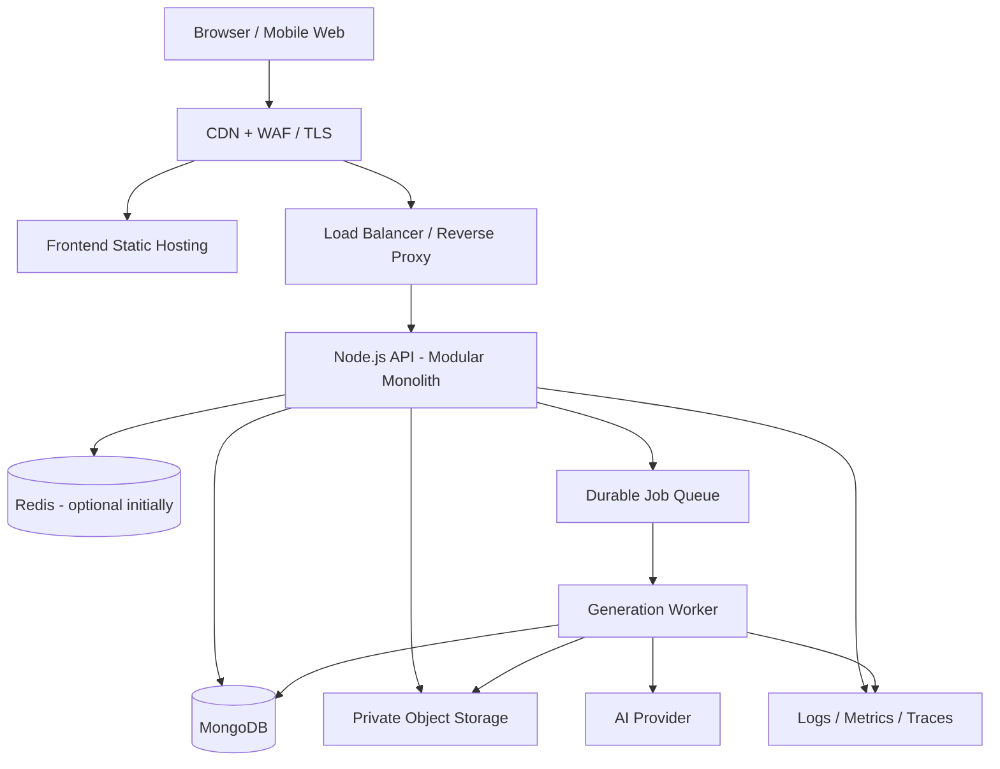

# SYSTEM_DESIGN.md — AI Mystery Room

**Status:** Proposed production architecture  
**Goal:** Build a robust, maintainable mystery-investigation application that can support approximately **10,000 registered users** and a realistic mix of concurrent active users.  
**Important:** 10,000 registered users is not the same as 10,000 simultaneous users. Capacity must be validated through workload modelling and load tests before claiming a production limit.

## 1. Architecture goals

The system should be secure, horizontally scalable, observable, cost-aware, and straightforward for a small engineering team to operate. Prefer a modular monolith plus background workers over premature microservices. Split services only when measured load, deployment independence, or team ownership justifies the additional operational complexity.

Primary requirements:

- Support 10,000 registered users with room to grow.
- Handle traffic spikes without losing case-generation requests or investigation progress.
- Keep AI-provider latency and failures from exhausting the API server.
- Enforce user/case ownership on every private resource.
- Keep canonical mystery solutions and answer-bearing metadata server-side until an authorized reveal.
- Persist user progress and accusations reliably.
- Provide bounded retries, rate limits, timeouts, health checks, metrics, logs, backups, and recovery procedures.
- Keep the codebase approachable, testable, and debuggable.

## 2. Proposed logical architecture

The frontend can be hosted separately on a CDN/static hosting platform. The API and generation workers should be deployed as independently scalable processes from the same repository or shared packages. A managed MongoDB deployment and managed object storage are preferred to self-hosted stateful infrastructure.

The queue shown above is required once generation is asynchronous. If an existing queue is not yet available, implement generation behind a worker interface and use a durable queue before enabling production traffic. Do not keep an HTTP request open while waiting on a slow AI provider.

## 3. Component responsibilities

| Component | Responsibility | Scaling strategy |
|---|---|---|
| Frontend | UI, routing, client-side validation, API calls | CDN/static hosting; cache versioned assets |
| API service | Auth, authorization, validation, case reads/writes, progress, accusations | Multiple stateless replicas behind a load balancer |
| Generation worker | AI calls, structured-output validation, case assembly, retries | Scale worker concurrency against provider quotas and queue depth |
| MongoDB | Users, cases, progress, accusations, jobs and metadata | Managed replica set; indexed queries; monitor connections and slow queries |
| Redis (optional) | Rate-limit counters, short-lived cache, distributed locks only when justified | Managed Redis; treat as disposable, not the source of truth |
| Durable queue | Generation jobs, retry scheduling, dead-letter handling | Managed queue or durable MongoDB-backed job mechanism with atomic claims |
| Object storage | Images and other generated/static media | Private bucket, signed URLs, CDN only for safe public assets |
| Observability | Logs, metrics, traces, alerting | Managed monitoring or self-hosted stack sized to actual needs |

Do not use in-memory process state for sessions, job ownership, rate limits, or authoritative progress if more than one API replica may run. A process restart must not lose accepted work.

## 4. Workload model and capacity planning

Do not equate a user count with a request rate. Define expected behavior and validate it.

Create at least three workload profiles:

1. **Normal:** representative daily active users, typical browsing, and a small number of concurrent generations.
2. **Peak:** expected event/launch traffic with a safety margin.
3. **Stress:** gradually increase concurrency until a defined bottleneck or service-level objective is exceeded.

Track these inputs:

- Registered users: 10,000 target.
- Daily active users and peak concurrent sessions: measure or explicitly assume.
- Read requests per active session and API calls per minute.
- Case-generation requests per minute and average/95th-percentile provider latency.
- Average case document size, number of suspects/evidence items, and media size.
- Notes/progress writes per session.
- Retention duration and expected growth in cases and media.
- AI provider request/token quotas, cost per generation, and concurrency limits.

Example planning model (illustrative, not a capacity claim):

- 10,000 registered accounts.
- 1,000 daily active users.
- 200 users active concurrently at peak.
- 5 ordinary API requests per active user per minute.
- 2 generation requests per minute during a peak burst.

This example implies approximately 1,000 ordinary requests/minute (about 17 requests/second), plus a separately controlled generation workload. Replace these assumptions with product analytics and load-test measurements. Generation concurrency should be bounded by provider quotas, not by the number of API replicas.

### Capacity acceptance targets

Set explicit service-level objectives before release. A reasonable initial target to test—not a guaranteed result—is:

- Read API latency: p95 under 300 ms for cached/simple indexed reads, excluding network distance.
- Ordinary write API latency: p95 under 500 ms for simple writes, excluding external AI calls.
- API availability: monthly target agreed by the team (for example, 99.5% at an early stage).
- Generation: show an immediate accepted/pending response; completion time is measured separately and communicated in the UI.
- No accepted job silently disappears; failed jobs are visible and recoverable.
- No cross-user access and no pre-reveal solution leakage.
- Load test passes at the agreed peak workload and a documented headroom factor (recommended starting point: 2× the expected peak).

Targets should be revised using measured baseline, product needs, and hosting/provider limits.

## 5. API request path

For a normal API request:

1. Terminate TLS at the managed edge/load balancer.
2. Apply request-size limits and edge protection.
3. Authenticate the session/token.
4. Validate input with a shared schema.
5. Enforce ownership and authorization in the service layer.
6. Execute an indexed database query or bounded write.
7. Serialize through an explicit public response DTO.
8. Return a stable response envelope and correlation/request ID.
9. Emit structured logs and metrics without sensitive content.

Avoid returning raw Mongoose documents. Use explicit serializers or DTOs so private fields cannot accidentally cross the API boundary.

## 6. Asynchronous AI generation

AI generation is the likely source of high latency, provider quota limits, and unpredictable failure. Isolate it from normal request handling.

Recommended flow:

1. `POST /cases` validates the request, checks quota, and creates a generation job with an idempotency key.
2. Return `202 Accepted` with a job ID and a status resource, or use the synchronous `201` behavior only if generation is demonstrably fast and bounded.
3. A worker atomically claims the queued job and records a lease/heartbeat.
4. Worker calls the AI provider with a timeout and bounded concurrency.
5. Parse structured output against a schema; reject malformed, incomplete, unsafe, or inconsistent output.
6. Validate internal references: suspect IDs, evidence IDs, timeline references, and canonical solution consistency.
7. Save the playable case and private solution atomically or through a recoverable state transition.
8. Mark the job completed and publish status for polling or server-sent events if implemented.
9. On transient failure, retry with exponential backoff and jitter. On permanent/exhausted failure, mark failed and expose a safe error.
10. Reconcile jobs stuck in `running` after worker crashes.

Operational rules:

- Never trust AI output as a validated domain object.
- Do not retry all failures. Retry transient network errors, 429s, and selected 5xx responses; handle invalid output and most 4xx errors explicitly.
- Respect `Retry-After` and provider quotas.
- Apply per-user and global generation limits.
- Set a maximum token budget, output size, time budget, and cost budget per generation.
- Never send provider API keys to the browser.
- Avoid logging raw prompts or complete generated solutions by default.
- Define whether failed generation consumes quota and whether users receive a retry or refund.
- Do not run multiple workers on one job without an atomic claim or queue-level exclusivity.
- Use a dead-letter queue or failed-job collection with a documented replay procedure.

## 7. Data model, indexes, and query discipline

Keep `DATA_MODEL.md` authoritative for collection fields and ownership rules. Add indexes based on actual query patterns, then verify them with explain plans.

Initial index candidates (confirm names and fields against the implementation):

| Collection | Candidate index | Purpose |
|---|---|---|
| users | Unique normalized email | Prevent duplicate accounts |
| cases | `{ ownerId: 1, updatedAt: -1 }` | User's case list sorted by recent activity |
| cases | `{ ownerId: 1, status: 1, updatedAt: -1 }` | Filter a user's cases by status |
| investigationprogress | Unique `{ userId: 1, caseId: 1 }` | One progress record per user/case |
| accusations | Unique `{ userId: 1, caseId: 1 }` if one attempt is allowed | Enforce attempt policy at the database layer |
| generationjobs | `{ status: 1, createdAt: 1 }` or queue-native equivalent | Find pending jobs for recovery |
| mediaassets | `{ caseId: 1 }` | Resolve case media metadata |

Avoid unbounded arrays and unbounded embedded histories. Paginate lists, cap notes/request sizes, limit maximum suspects/evidence per generated case, and avoid fetching full media binaries through the API. Keep query projections narrow and use lean/read-only query paths where appropriate. Add indexes only when a query needs them; extra indexes increase write cost and storage.

If a case embeds all suspects/evidence and stays small and bounded, this can be reasonable. If cases become large or frequently updated, move high-volume subdocuments into separate collections only after measuring document size, update contention, and query cost.

## 8. Caching strategy

Start without broad caching unless measurements justify it. Correctness and authorization come first.

Safe candidates:
- Versioned frontend assets: long-lived CDN cache.
- Public static assets: CDN cache with immutable versioned URLs.
- Non-sensitive reference/configuration data: short-lived cache if needed.
- Read-only case metadata: cache only with an explicit owner-aware cache key, short TTL, and invalidation strategy.

Do not cache private solutions, personalized progress, accusation results, or authenticated responses in a shared CDN cache. Do not use cache as the authoritative store for job state, attempt limits, or user progress. Include user/case identity in any private cache key, and test cross-user isolation.

## 9. Security and privacy

- Enforce ownership on every private read, write, delete, export, and media request.
- Keep the canonical solution and hidden clue metadata server-side until authorized reveal.
- Use secure, HTTP-only, SameSite cookies for cookie-based sessions; use CSRF protections where required by the architecture. If bearer tokens are used, define secure storage and rotation explicitly.
- Hash passwords using a modern password hashing algorithm through a well-maintained library. Never store plaintext passwords.
- Validate and bound every input, including IDs, pagination, note content, and generation options.
- Apply rate limits by IP and account, with stricter limits for login, registration, generation, and accusation endpoints.
- Use least-privilege database and object-storage credentials.
- Keep private media in private buckets and deliver it through authorization checks or short-lived signed URLs.
- Store secrets in the deployment platform's secret manager; rotate credentials and never commit `.env` files.
- Configure TLS, security headers, CORS allowlists, request-size limits, and safe error responses.
- Protect logs from tokens, passwords, private solutions, and unnecessary personal data.
- Establish account deletion, data retention, backup retention, and incident-response policies.
- Treat AI output as untrusted input: schema-validate it, sanitize rendered text, and do not allow model output to select executable code, URLs, or privileged operations.

## 10. Reliability, consistency, and idempotency

- Give each request a correlation ID and each generation job a durable ID.
- Use idempotency keys for operations that clients may retry, especially case generation. Store the key with user identity and request fingerprint; reject reuse with a different payload.
- Use unique indexes as the final guard for one-attempt accusation policy.
- For multi-document state changes, use a MongoDB transaction where supported and justified, or design an explicit recoverable state machine. Do not assume several separate writes are atomic.
- Use optimistic concurrency/version fields for mutable progress or notes if conflicting updates matter.
- Set database connection-pool limits based on deployment replica count. Total possible connections are approximately pool size × replica count; monitor against database limits.
- Use graceful shutdown: stop accepting new work, finish or release active jobs, close database/queue connections, and then exit.
- Define timeouts for all network calls. Do not permit unbounded retries.
- Use exponential backoff with jitter and circuit-breaker behavior where appropriate for unstable dependencies.
- Add readiness/liveness checks. A readiness failure should remove a replica from traffic; liveness should not restart healthy processes just because the AI provider is temporarily unavailable.

## 11. Observability and alerting

Use structured JSON logs and metrics with correlation IDs. Avoid logging secrets or complete private mystery payloads.

Minimum metrics:
- Request count, error rate, and p50/p95/p99 latency by route and status class.
- Database operation latency, connection-pool saturation, slow queries, and connection failures.
- Queue depth, oldest queued-job age, active workers, retries, failed jobs, and generation duration.
- AI provider latency, timeout/429/5xx rates, token usage, and cost per successful case.
- Authentication failures, rate-limit events, and authorization denials.
- Frontend JavaScript errors and core web vitals, subject to privacy requirements.
- Storage usage, backup status, and deployment health.

Alert on sustained API error/latency regressions, queue age beyond the product's expected wait, provider quota exhaustion, database saturation, repeated worker crashes, failed backups, and unusual authorization-denial spikes. Every alert needs an owner, a severity, and a runbook.

## 12. Deployment and environments

Maintain separate local, test/CI, staging, and production environments. Never use production user data in development unless formally approved and appropriately minimized.

- Build immutable application artifacts and promote the same artifact between environments.
- Run automated checks before deployment: formatting/lint, typecheck where configured, unit tests, API integration tests, security/privacy tests, and production build.
- Use backward-compatible database migrations: deploy code that can tolerate the old and new schema, migrate data, then remove old fields in a later release.
- Use health checks and rolling/gradual deployments where supported.
- Keep a rollback procedure for application deployments and a separate recovery plan for irreversible data migrations.
- Store environment configuration in documented variables; validate required variables at startup without printing their values.
- Pin runtime and dependency versions. Review dependency vulnerabilities and lockfile changes.
- Avoid deploying destructive database changes and application changes simultaneously without a tested migration plan.

## 13. Backups and disaster recovery

- Use managed automated database backups and point-in-time recovery where available.
- Define recovery point objective (RPO) and recovery time objective (RTO) with the project owner; do not leave them implicit.
- Back up object-storage metadata and ensure media retention matches the case retention policy.
- Restrict backup access and encrypt backups at rest and in transit.
- Test restore procedures on a schedule. A backup that has never been restored is not verified.
- Document recovery steps for database loss, accidental deletion, compromised credentials, queue outage, and AI-provider outage.
- Decide whether generation jobs can be safely replayed after restore and how idempotency prevents duplicates.

## 14. Load and failure testing

Use k6, Artillery, or an equivalent load-testing tool against a staging environment with representative seeded data.

Required scenarios:
1. Ramp up to the agreed normal load, hold steady, and ramp down.
2. Ramp to expected peak and hold long enough to expose connection and memory issues.
3. Run a 2× peak headroom test if provider and staging quotas permit.
4. Test read-heavy browsing separately from AI generation.
5. Simulate provider latency, 429 responses, timeouts, and 5xx errors.
6. Simulate database latency and transient connection failure.
7. Run soak tests to find leaks, queue growth, and resource exhaustion.
8. Validate authorization and private-data boundaries under concurrent requests.

Measure throughput, error rate, p95/p99 latency, CPU/memory, database connections, queue age, provider quotas, and cost. A test is not successful merely because requests return 200; validate response correctness and persisted state.

Do not load-test a third-party AI provider aggressively without authorization. Use a deterministic mock for high-volume tests and a controlled real-provider smoke test.

## 15. Scaling stages

**Stage 1 — Reliable baseline**
- One modular API codebase, managed database, private object storage, durable generation queue, worker process, CI, backups, and basic metrics.
- Explicit validation, authorization, bounded payloads, indexes, and server-only solution storage.
- No unnecessary distributed services.

**Stage 2 — Scale API and workers independently**
- Multiple stateless API replicas behind a load balancer.
- Increase worker replicas subject to provider quotas and queue depth.
- Tune database indexes, pool limits, and query projections from measured traces.
- Add Redis only for a clear need such as distributed rate limiting or a high-hit-rate cache.

**Stage 3 — Optimize measured bottlenecks**
- Add targeted caching, read replicas, separate media delivery, or collection decomposition only when metrics support the change.
- Partition or shard data only when managed database capacity and query patterns demonstrate the need.
- Split services only where independent scaling or ownership offsets the operational cost.

## 16. Definition of done

- [ ] A documented workload model defines normal, peak, and stress traffic.
- [ ] Load tests meet the agreed SLOs at peak and the documented headroom target.
- [ ] API instances are stateless and can be scaled horizontally.
- [ ] Generation runs through a durable, bounded, observable worker flow.
- [ ] Idempotency, retry limits, stuck-job recovery, and failed-job handling are tested.
- [ ] Critical queries have verified indexes and bounded result sizes.
- [ ] No cross-user data access or pre-reveal solution leakage is possible in tests.
- [ ] Dashboards, alerts, logs, backups, and restore/runbook procedures are operational.
- [ ] Secrets, environment variables, migrations, rollback, and incident handling are documented.
- [ ] Actual hosting limits, provider quotas, measured capacity, and known bottlenecks are recorded.

## 17. Related documents

Use `API.md` for HTTP contracts, `DATA_MODEL.md` for persistence and data boundaries, `ACCEPTANCE_TESTS.md` for verifiable release behavior, `USER_FLOWS.md` for user journeys, and `DESIGN_SPEC.md` for UI design constraints. When implementation changes a contract, update the relevant document in the same pull request.
