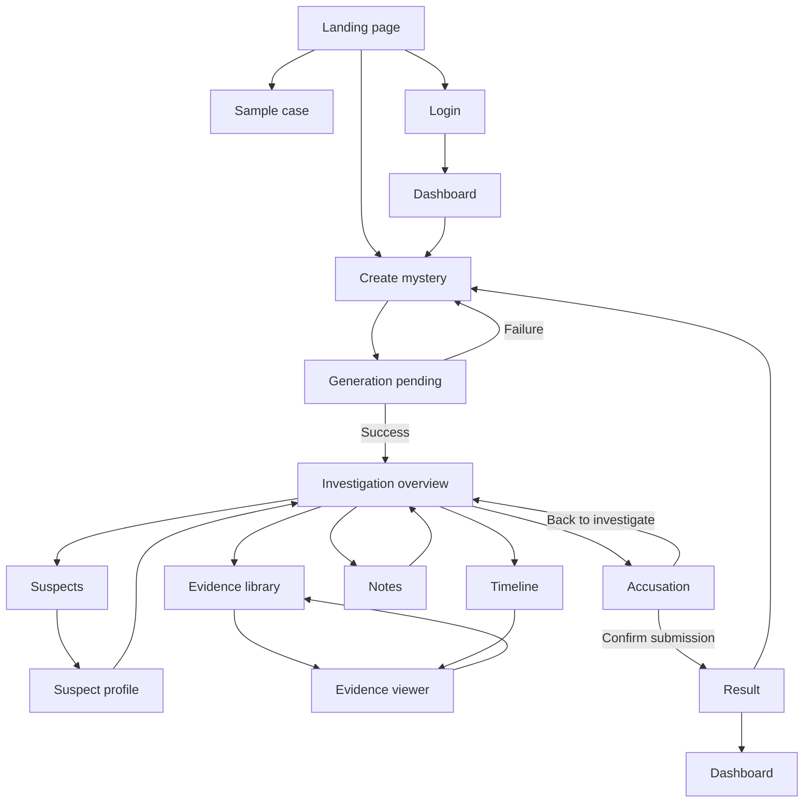
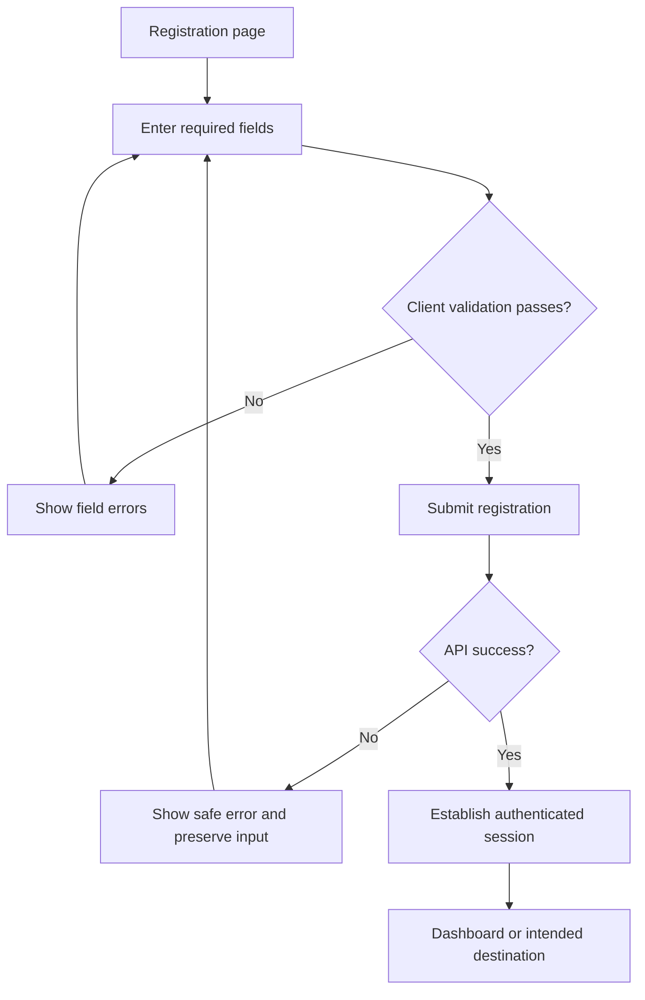
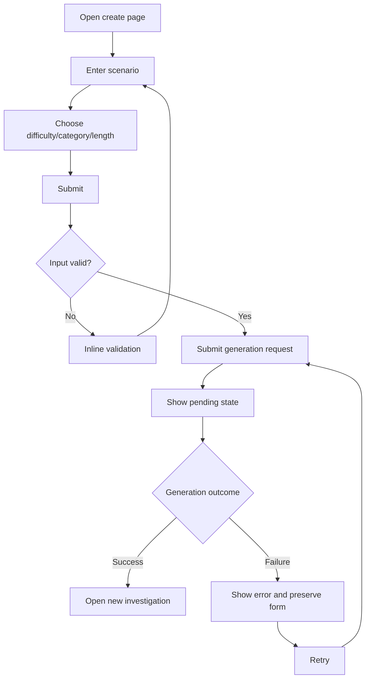
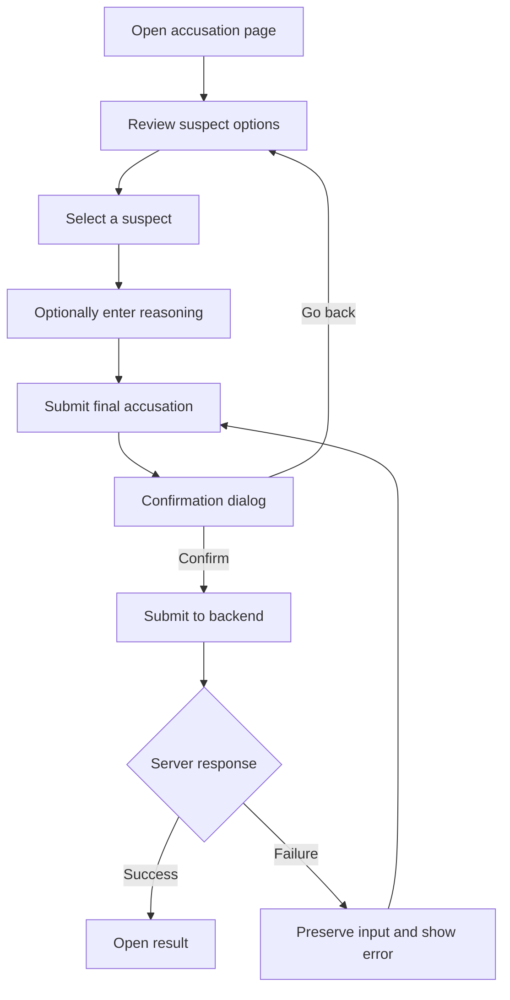

# AI Mystery Room — User Flows & Interaction Contracts

**Document:** `docs/USER_FLOWS.md`  
**Version:** 1.0.0  
**Status:** Authoritative user-journey and interaction specification  
**Product:** AI Mystery Room  
**Related documents:** `docs/SPEC.md`, `docs/DESIGN_SPEC.md`  
**Audience:** Codex, frontend/backend engineers, QA

---

## 0. Purpose and authority

This document defines how users move through AI Mystery Room, what happens after every meaningful interaction, how screen transitions work, and how exceptional conditions must be handled.

- `SPEC.md` owns product behavior, architecture, security, data models, and API contracts.
- `DESIGN_SPEC.md` owns visual design, components, responsive layouts, and motion.
- `USER_FLOWS.md` owns navigation maps, user journeys, interaction contracts, and flow-specific edge cases.

These documents must remain consistent. If an implementation choice affects a user-visible flow, update this document alongside the code. Never silently change the final-accusation policy, solution reveal policy, authentication policy, or persistence behavior.

## 1. Global flow rules

1. Every visible interactive element must have a defined action and outcome.
2. Navigation must preserve context when users open and return from evidence, suspect profiles, notes, and timeline events.
3. Use browser history appropriately. The Back action must not silently discard unsaved work.
4. Protected routes require backend authorization; hiding a button is not authorization.
5. Loading, success, empty, and error states are part of each flow, not optional polish.
6. Do not display fake progress, fake save confirmations, or fake media playback.
7. Prevent duplicate submissions for generation, notes saves where relevant, and final accusations.
8. User input should survive recoverable network or provider errors.
9. The canonical culprit and private solution must never be sent to or rendered by the client before authorized case completion.
10. All actions must be usable with keyboard, pointer, and touch as applicable.
11. Use the system's reduced-motion setting for transitions.
12. Never infer success from a click. Update UI state only after a successful operation or a clearly defined optimistic-update strategy with rollback.

---

# 2. Global navigation map

This map describes the primary flow. It does not imply that every route is publicly accessible. Authentication and case ownership rules are defined in `SPEC.md`.

## 2.1 Navigation rules

- Landing page: primary CTA opens `/create`.
- Authenticated user: dashboard is the default post-login destination unless a valid protected destination was requested.
- Case creation success: navigate to the newly created case's investigation overview.
- Evidence open: navigate to the selected evidence while retaining case context.
- Evidence close/back: return to the previous investigation location, not always to the case overview.
- Suspect profile open/back: return to the suspect list and preserve scroll position when feasible.
- Accusation: users can return to investigation before final submission.
- Final accusation: if the product is configured for one final attempt, confirmation locks the answer; subsequent visits show the existing result.
- Completed case: opening it navigates to the result/review experience, not to a new accusation form.
- Browser refresh: preserve route and restore authorized state from the backend.
- Invalid or unauthorized case route: show a safe unavailable/access-denied state without revealing whether a private case exists.

---

# 3. Flow A — First visit and landing page

## Trigger

The user opens `/`.

## Steps

1. Render the landing page shell and primary content.
2. User can choose “Start investigating”.
3. User can choose “Explore a sample case” if a real sample case is configured.
4. User can use navigation to sign in or register if authentication is enabled.
5. If the user chooses the primary CTA, navigate to `/create`.
6. If the user chooses a protected feature, route through authentication and preserve the intended destination when safe.

## Interaction contracts

| Element | Action | Expected result |
|---|---|---|
| Wordmark | Navigate to `/` | Landing page |
| Start investigating | Navigate to `/create` | Mystery creation form |
| Sample case | Open configured sample case | Real sample investigation or clear unavailable state |
| Login | Navigate to `/login` | Login form |
| Register | Navigate to `/register` | Registration form |
| How it works | Scroll or navigate to section | Correct section, without hiding it under sticky navigation |

## Edge cases

- If sample case data is unavailable, do not route to a broken case. Hide the CTA or show a clear unavailable message.
- If authentication is already active, do not force the user to sign in again.
- If a route is not implemented, do not show a dead link.
- The page must remain usable if decorative assets fail to load.

---

# 4. Flow B — Registration, login, logout, and session expiration

## 4.1 Registration

### Contract

- Validate required fields before submission.
- Disable duplicate submission while the request is pending.
- Display field-level errors when the API returns actionable validation errors.
- Do not expose password hashes or internal server errors.
- On success, update authentication state from the authoritative response/session.
- Navigate to the intended destination only if it is a valid internal route; otherwise use `/dashboard`.

## 4.2 Login

1. User opens `/login`.
2. Enters credentials.
3. Client validates basic input format.
4. Client submits to the API.
5. While pending, disable duplicate submission and show loading state.
6. On failure, display a safe message and preserve the email field.
7. On success, update auth state and navigate to the valid intended route or dashboard.

### Edge cases

- Invalid credentials: show a generic authentication failure consistent with the auth policy.
- Rate limited: explain that the user should wait before retrying.
- Network failure: retain form input and offer retry.
- Expired session: clear protected UI state and require reauthentication where necessary.
- Existing session: redirect away from login only if the current session has been verified.

## 4.3 Logout

1. User opens account menu.
2. Chooses “Sign out”.
3. Client calls logout endpoint.
4. On success, clear client authentication state and navigate to `/`.
5. On recoverable network failure, follow the server/session policy; do not falsely claim the server session was revoked.
6. Clear cached protected case data from client state when the session ends.

## 4.4 Session expiration

- If a protected API returns an authentication-expired response, stop protected mutations.
- Preserve non-sensitive unsent form input when safe.
- Display a clear session-expired message.
- Navigate to login when required, preserving only a safe internal return route.
- Never continue displaying private case data as if authorization remained valid.

---

# 5. Flow C — Create a mystery

## Trigger

The user opens `/create` from the landing page or dashboard.

## Main path

## Interaction contracts

| Element | Action | Contract |
|---|---|---|
| Scenario textarea | Type/paste | Preserve text; enforce configured length |
| Character counter | Update on input | Reflect actual character count |
| Example prompt | Click | Populate the scenario field; do not auto-submit |
| Difficulty control | Select | Update selected value and accessible state |
| Category control | Select | Update selected value |
| Length control | Select | Update selected value |
| Create mystery | Submit | Validate, then send exactly one generation request |
| Retry | Submit again | Reuse preserved values; do not duplicate a still-running job |
| Return/back | Navigate away | Warn only if meaningful unsaved input would otherwise be lost; do not over-warn |

## Validation rules

- Empty or whitespace-only prompt: block submission and focus the field.
- Prompt below configured minimum: show an actionable error.
- Prompt over maximum: prevent further input or show an explicit validation error according to implementation convention.
- Invalid option value: reject before API submission.
- User is unauthenticated: follow the configured guest/authentication policy.
- Server validation remains authoritative even if client validation passes.

## Pending state

- Disable the primary submit button.
- Prevent duplicate requests.
- Preserve form content.
- Show an indeterminate loader unless real progress data is available.
- Keep the page accessible and responsive.
- Do not invent a percentage or claim that a specific generation stage is complete unless the backend provides that status.

## Success

- Confirm the response contains a valid case ID.
- Navigate to `/case/:caseId`.
- Fetch authorized public case data.
- Initialize progress if the backend contract requires it.
- Do not put the private solution in route state, query parameters, local storage, or client fixtures.

## Failure and retry

- Preserve the prompt and all settings.
- Show a concise error and retry action.
- If a generation job may still be running, check its status before submitting another generation request.
- If the provider returns a rate limit, respect the retry policy and do not create a rapid retry loop.
- If the response is malformed or lacks a case ID, treat it as a failure rather than navigating to an invalid route.

---

# 6. Flow D — Dashboard and case history

## Main path

1. User opens `/dashboard`.
2. Frontend fetches the user's authorized cases.
3. Render loading skeletons while the request is pending.
4. On success, show active and completed cases.
5. User selects a case action.
6. Navigate based on the authoritative case status.

## Interaction contracts

| Element | Action | Result |
|---|---|---|
| New investigation | Navigate to `/create` | Creation form |
| Active case card | Resume | Open `/case/:caseId` |
| Completed case card | Review solution | Open `/case/:caseId/result` |
| Active/completed filter | Change filter | Update visible case list |
| Search, if implemented | Enter query | Filter supported case fields |
| Overflow menu | Open | Show permitted case actions |
| Delete case | Confirm | Call delete API; remove card only after success |
| Retry | Retry failed load | Refetch case list |

## State contracts

- Loading: stable skeletons.
- Empty: clear explanation and create CTA.
- Error: safe error message and retry.
- Partial metadata: show known fields only; do not fabricate dates or progress.
- Delete pending: disable duplicate deletion.
- Delete success: remove the card and announce completion.
- Delete failure: keep/restore the card and display an error.

## Edge cases

- A case may have been deleted in another session. If opening it returns unavailable, refresh the dashboard and show a safe message.
- A completed case must not be routed to an active accusation flow.
- A case still generating must not appear as playable until the backend marks it active.
- Case count and progress must be derived from returned data.

---

# 7. Flow E — Enter and navigate an investigation

## 7.1 Opening a case

1. Navigate to `/case/:caseId`.
2. Fetch the authorized public case representation.
3. Fetch progress separately if required by the API contract.
4. Show a loading shell while pending.
5. If active, render the investigation overview.
6. If completed, navigate to the result/review route.
7. If failed, deleted, unauthorized, or unavailable, show the appropriate safe state.

## 7.2 Main navigation

Sections:

- Overview
- Suspects
- Evidence
- Timeline
- Notes

Navigation must work by click, keyboard, touch, and browser history where appropriate.

When moving between sections:
- Preserve case ID.
- Preserve the user's investigation context.
- Preserve scroll position when returning to a list, where feasible.
- Avoid unnecessary refetches if data is fresh and the caching strategy permits it.
- Do not preserve stale protected data after authorization loss.

## 7.3 Suspect navigation

1. User opens Suspects.
2. Render the suspect list from authorized public case data.
3. User selects a suspect.
4. Open the suspect profile with the stable suspect ID.
5. User can open permitted related evidence.
6. User returns to the suspect list and the prior list position is restored when feasible.

### Edge cases

- Missing portrait: show initials or a neutral placeholder.
- Invalid suspect ID: show a not-found state within the case context.
- Empty optional fields: omit the field or show a neutral “Not available” label where meaningful; do not invent data.
- A suspect's public profile must never contain private solution notes.

---

# 8. Flow F — Evidence discovery and viewing

## 8.1 Evidence library

1. User opens Evidence.
2. Fetch or render authorized evidence metadata.
3. User may filter by supported evidence type.
4. User opens an evidence item.
5. Navigate to `/case/:caseId/evidence/:evidenceId`.
6. Fetch the authorized public evidence detail.
7. Render the correct type-specific viewer.
8. Mark as reviewed only when the API supports it and the operation succeeds.
9. Return to the prior list with filter and scroll state preserved where feasible.

## 8.2 Evidence interactions

| Element | Action | Expected behavior |
|---|---|---|
| Evidence card | Activate | Open selected evidence |
| Evidence filter | Select type | Show matching evidence only |
| Clear filters | Activate | Restore all evidence |
| Related evidence link | Activate | Open related item while retaining case context |
| Back/close | Activate | Return to previous context |
| Mark reviewed | Activate, if supported | Submit update and show confirmed state only after success |
| Previous/next | Activate, if implemented | Move through the defined evidence order |
| Zoom | Activate | Enlarge image with keyboard-accessible close |
| Retry media | Activate, if supported | Retry asset request |

## 8.3 Context preservation

When returning from an evidence viewer, preserve:
- Current case.
- Current evidence filter.
- List scroll position when feasible.
- Current investigation section.
- Unsaved notes in component state until save status is resolved.

Do not preserve the canonical solution or private clue classifications in client caches.

## 8.4 Evidence-specific contracts

### Chat
- Message order is chronological according to the supplied evidence data.
- Participant identities remain consistent throughout the conversation.
- Long messages wrap.
- Deleted/edited markers appear only if present in data.
- Provide a linear accessible reading order.

### Image
- Reserve image dimensions to prevent layout shift.
- Show truthful metadata and caption.
- Failed images retain the evidence record and display an unavailable state.
- Zoom is dismissible and keyboard accessible.

### Surveillance
- Use real playback controls only for a real video asset.
- A simulated sequence must be labelled as a reconstruction/simulation.
- Never claim that a textual description is a video.
- Do not autoplay sound.

### Document/forensic report
- Use readable document typography and section headings.
- Preserve text selection and zoom.
- Do not highlight decisive lines before solution reveal unless that emphasis is part of the public evidence itself.

### Logs and records
- Use labelled columns on desktop.
- Stack records on mobile when a wide table would be unreadable.
- Preserve timestamp and identifier values exactly as supplied.

## 8.5 Evidence errors

- Evidence not found: safe not-found state; do not expose other evidence or solution details.
- Unauthorized: stop rendering protected content.
- Media missing: render metadata and clear fallback.
- API failure: retry action where safe.
- Invalid evidence relationship: omit the broken relationship and log a sanitized diagnostic; do not fabricate a replacement link.

---

# 9. Flow G — Timeline and evidence relationships

## Timeline path

1. User opens Timeline.
2. Render available timeline events in chronological order.
3. Each event shows its timestamp and description.
4. If linked evidence exists, show a link to the corresponding authorized evidence item.
5. User opens linked evidence.
6. User returns to the timeline with the prior position preserved where feasible.

## Interaction contracts

- Sort using canonical event timestamps from the backend.
- Do not invent a timestamp for unknown data.
- Distinguish event time from evidence acquisition/recovery time.
- Use a vertical timeline on mobile.
- A relationship line is shown only when a valid relationship exists in data.
- Do not expose private clue labels or imply that a clue is decisive before the reveal.

## Edge cases

- No timeline: show a designed empty state and return link.
- Missing linked evidence: show the event without the broken link and log the issue.
- Equal timestamps: preserve stable source order or use a documented deterministic secondary sort.
- Invalid timestamp: label as unknown if the product supports it; never silently invent a date.

---

# 10. Flow H — Notes and persistence

## Main path

1. User opens Notes or a notes panel.
2. Load the user's notes for this case.
3. User enters or edits text.
4. Save explicitly or autosave according to the implemented contract.
5. Show Saving only while a request is pending.
6. Show Saved only after successful persistence.
7. On failure, preserve the unsaved text and show a retry action.

## Interaction contracts

- Notes belong to the authenticated user and case.
- Notes must not modify case evidence or the canonical solution.
- Autosave must be debounced and race-safe if implemented.
- Older save responses must not overwrite newer text in the UI.
- Leaving the page with unsaved edits must warn the user only when the edits are genuinely at risk.
- Do not show “Saved” based solely on local input state.
- Notes must not be sent to the AI assistant unless a separately defined feature explicitly authorizes it and communicates that behavior.

## Conflict handling

If the backend supports note versions or timestamps:
- Detect a conflict where the server version changed after the local copy was loaded.
- Preserve the user's local text.
- Provide a deliberate reload/resolve action rather than silently overwriting newer data.

If version conflict handling is not supported by the API, document the limitation and use the safest available last-write strategy.

---

# 11. Flow I — Final accusation

## 11.1 Preconditions

- Case is active.
- User is authorized to access it.
- Selected suspect exists in the case.
- No final accusation has already been submitted, if the game allows only one attempt.
- The backend remains authoritative for all preconditions.

## 11.2 Main flow

## 11.3 Interaction contracts

- No suspect is selected by default.
- Selecting a suspect produces a visible selected state and correct radio semantics.
- The final action remains disabled until a valid suspect is selected.
- Confirmation identifies the selected suspect and explains the finality of the action.
- Confirmation can be dismissed without submitting.
- Once confirmed, disable repeated submissions while pending.
- Only a successful authoritative response transitions the UI to the completed result.
- A timeout does not prove that the submission failed. Refetch case/result state before allowing another final submission.
- If a previous accusation already exists, retrieve and show the existing result according to the backend contract.
- The frontend must not determine correctness by reading a client-side culprit field.

## 11.4 Failure cases

- Invalid suspect: show a validation error; do not complete the case.
- Case already completed: retrieve the existing result.
- Network failure: preserve suspect and reasoning; resolve ambiguous submission status before retry.
- Unauthorized: stop protected rendering and follow the auth flow.
- Server error: show a safe message and preserve form data.
- Duplicate request: backend must prevent duplicate final accusations.

---

# 12. Flow J — Results and solution reveal

## Main path

1. User arrives at `/case/:caseId/result`.
2. Backend verifies access and completion status.
3. If no completed result exists, redirect to the active investigation or show a safe state according to the API contract.
4. Fetch authorized result data.
5. Render correct/incorrect outcome.
6. Reveal culprit, motive, method, timeline, decisive evidence, and red-herring explanations.
7. User can open the cited evidence or return to dashboard.

## Interaction contracts

- Do not request or render private solution data before authorization.
- Correct and incorrect results have distinct labels, icons, and semantic colors.
- Evidence links open the correct case evidence item.
- If a result response is incomplete, show the available verified data and a retry/error state; do not invent missing rationale.
- Do not force a cinematic animation before revealing the result.
- Reduced-motion users receive the same information immediately.
- Do not score reasoning using AI unless that feature is separately specified and approved.

## Edge cases

- Result route opened before completion: route to the active case or display an appropriate message.
- Result retrieval failure: retry without exposing partial private data.
- Case deleted: show safe unavailable state.
- Missing decisive evidence reference: show the available explanation and omit broken navigation; do not invent evidence.
- Browser refresh: result remains accessible only if the server confirms authorized completion.

---

# 13. Flow K — Case deletion and destructive actions

1. User opens the relevant overflow menu.
2. User chooses Delete.
3. Confirmation dialog names the action and explains what data will be removed.
4. User confirms or cancels.
5. On confirmation, call the backend.
6. Show pending state and prevent duplicate requests.
7. On success, remove the case from the UI and navigate to a safe destination.
8. On failure, retain the case and show a retryable error.

Rules:
- Do not optimistically remove a case permanently before server success unless rollback is implemented.
- Delete related progress and media according to the backend's defined deletion policy.
- No destructive action is triggered by a card click or an ambiguous icon.
- Cancel always leaves the data unchanged.

---

# 14. Flow L — Sample case

A sample case must use a real configured sample-case record or an explicit fixture route intended for demonstration.

- Landing CTA opens the configured sample.
- The UI identifies it as a sample/demo case.
- If sample data is unavailable, hide the CTA or display a truthful unavailable state.
- Sample data must not be confused with a user's saved investigation.
- The sample case must obey the same public/private solution separation.
- Do not place the sample culprit in HTML metadata, page source, or client-visible initial state before its reveal.

---

# 15. Authentication and authorization guards

## Protected navigation contract

- If authentication is required, a user who opens a protected route while signed out is redirected to login with a validated internal return path.
- After login, navigate to the requested route only if it remains valid and authorized.
- Never accept arbitrary external redirect URLs.
- When a protected API returns unauthorized, stop protected mutations and clear sensitive client state.
- When a protected API returns forbidden/not-found, display a safe unavailable state.
- Do not use a frontend route guard as a substitute for backend authorization.

## Stale state contract

- A user's cached case must not remain visible after logout or session loss.
- On account switch, clear previous user's case, notes, and progress state.
- Do not persist hidden solution data in local storage, session storage, URL query parameters, route state, or browser history.

---

# 16. Global screen-state contract

Every data-driven screen must implement the states relevant to its operations.

| State | Required UI | Required behavior |
|---|---|---|
| Initial loading | Skeleton or localized spinner | Prevent duplicate mutation; preserve shell |
| Empty | Explanation plus relevant action | Do not render fake records |
| Success | Actual returned data | Enable valid actions |
| Validation error | Inline field error | Focus/announce error where appropriate |
| Recoverable API error | Clear message and retry if safe | Preserve input/context |
| Unauthorized | Login/session flow | Clear protected state |
| Forbidden/unavailable | Safe unavailable page/state | Do not disclose private case existence |
| Pending mutation | Disabled duplicate action plus status | Do not imply success |
| Partial data | Available fields plus clear omissions | Never fabricate missing values |
| Missing media | Metadata and fallback | Do not claim playback/generation succeeded |
| Offline/network failure | Connection message | Do not claim data was saved |
| Completed case | Result/review state | Do not reopen final accusation flow |

---

# 17. Screen transition and browser-history rules

- Use route transitions only if compatible with the existing router and accessibility behavior.
- The browser Back button must return to the prior meaningful context.
- Opening evidence from a filtered list must restore the filter and list position where feasible.
- Opening a suspect profile must preserve the suspect-list context.
- Switching investigation sections must not erase unsaved notes.
- A modal opening moves focus into it; closing restores focus to the trigger.
- A drawer must be dismissible using its visible close control and Escape where appropriate.
- Navigation must not unexpectedly scroll users to the middle of a page unless restoring a prior scroll position.
- Avoid double transitions caused by both route animation and nested component animation.
- Do not animate protected content into view after authorization has been lost.

---

# 18. Error recovery matrix

| Situation | UI response | Data behavior |
|---|---|---|
| Generation fails | Error panel with retry | Preserve prompt/options |
| Generation response lacks case ID | Treat as failure | Do not navigate |
| Evidence API fails | Error panel and retry | Preserve case context |
| Image fails | Media fallback | Preserve evidence metadata |
| Video unavailable | Honest simulated/unavailable state | Never fake playback |
| Notes save fails | “Not saved” message and retry | Preserve local text |
| Accusation times out | Check authoritative result/status | Avoid duplicate final submission |
| Delete fails | Error and retry | Keep case visible |
| Session expires | Sign-in flow and message | Clear protected state |
| Route ID invalid | Safe unavailable state | Do not expose other cases |
| Linked evidence missing | Omit broken link and log | Do not fabricate relationship |

---

# 19. Interaction-contract format for future features

Any new interactive feature must be documented with these fields before implementation:

1. **Name:** concise feature name.
2. **Entry condition:** where and when it is available.
3. **Trigger:** exact user action.
4. **Preconditions:** authorization, required data, and valid state.
5. **Pending state:** what is disabled and what status is shown.
6. **Success result:** navigation and state changes.
7. **Failure result:** error message, retained data, and retry behavior.
8. **Cancellation:** whether cancellation is supported and its effects.
9. **Accessibility:** keyboard, focus, labels, and announcements.
10. **Responsive behavior:** mobile/tablet/desktop differences.
11. **Security boundary:** data that must not be exposed.
12. **Acceptance test:** observable pass/fail criteria.

Do not implement controls with no defined behavior. If a feature is not implemented, omit the control or mark it as unavailable with a truthful explanation.

---

# 20. QA checklist

## Navigation
- [ ] Every visible link/button navigates or performs a real action.
- [ ] Back navigation preserves context where specified.
- [ ] Protected routes follow the authentication policy.
- [ ] Invalid route IDs show safe states.

## Forms and mutations
- [ ] Validation is both client-side and server-side.
- [ ] Duplicate submissions are prevented.
- [ ] Pending states are visible.
- [ ] Failures preserve user input.
- [ ] Success states reflect actual server confirmation.

## Investigation
- [ ] Suspect and evidence navigation works.
- [ ] Evidence type controls open the correct viewer.
- [ ] Timeline links open the correct evidence.
- [ ] Notes persistence is truthful.
- [ ] No hidden solution leaks before completion.

## Accusation and reveal
- [ ] No suspect is preselected.
- [ ] Finality is explained before confirmation.
- [ ] Network timeout is handled without accidental duplicate accusation.
- [ ] Result route requires authorized completion.
- [ ] Result links and explanations use real data.

## Accessibility and responsiveness
- [ ] Keyboard-only navigation works.
- [ ] Focus is visible and restored after dialogs.
- [ ] Screen-reader labels and status announcements exist.
- [ ] Reduced-motion behavior is respected.
- [ ] 360px, 390px, 768px, 1024px, 1280px, and 1440px viewports are tested.
- [ ] No horizontal overflow.
- [ ] Mobile keyboard does not cover essential form actions.

---

# 21. Final rule

Every user journey must be coherent from entry to completion. The application must never pretend that an action succeeded, expose private case data, fabricate media or progress, or strand users in an unrecoverable state.

**The experience should feel like a tactile, colorful detective game while behaving like a reliable, secure web application.**

**End of `docs/USER_FLOWS.md` — Version 1.0.0**
