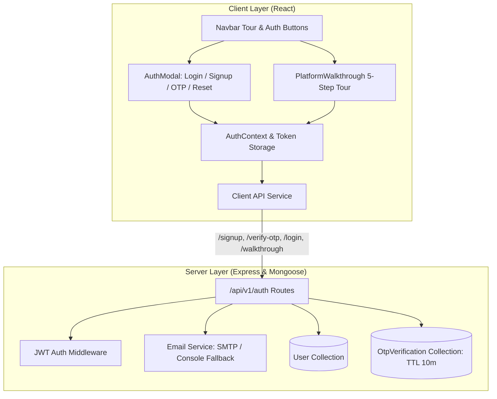

# Email OTP Authentication & Interactive Platform Walkthrough Implementation Plan

> **For agentic workers:** REQUIRED SUB-SKILL: Use superpowers:subagent-driven-development to implement this plan task-by-task. Steps use checkbox (`- [ ]`) syntax for tracking.

**Goal:** Implement full-stack user authentication with email OTP verification (signup, login, forgot/reset password), a resilient email dispatch service with dev fallback, authenticated session management, and a 5-step interactive Neo-Brutalist platform walkthrough tour with a persistent "Skip" option.

**Architecture:**
- **Server:** Node.js + Express + Mongoose with `User` and `OtpVerification` models, `bcryptjs` for credential hashing, `jsonwebtoken` for auth tokens, `nodemailer` with console fallback for OTP dispatch, and protected `/api/v1/auth` endpoints.
- **Client:** React + Tailwind Neo-Brutalism with `AuthContext` injecting Bearer tokens into `api.js`, multi-state `AuthModal` (Login, Signup, 6-digit OTP code, Password Reset), and `PlatformWalkthrough` floating spotlight card (5 steps with "Skip Tour" and Navbar replay trigger).

**Architecture Diagram:**

**Tech Stack:** Node.js, Express, Mongoose, `bcryptjs`, `jsonwebtoken`, `nodemailer`, React 19, Vite, Tailwind CSS, Lucide icons, Vitest.

**Spec:** [`Docs/superpowers/specs/2026-10-25-email-otp-auth-and-walkthrough-design.md`](file:///c:/Users/yuvra/OneDrive/Desktop/AI%20Mystery%20Room/Docs/superpowers/specs/2026-10-25-email-otp-auth-and-walkthrough-design.md)

---

## Global Constraints

- **Security & Integrity:** Passwords must be hashed with `bcryptjs` (salt rounds = 10). OTPs must be cryptographically generated 6-digit integers, hashed in the database, and expired after 10 minutes (TTL index). Max 5 attempts per OTP before lockout.
- **Developer Resilience:** When SMTP credentials are not configured in `.env`, `emailService` must format and output the OTP in the terminal console without throwing, allowing instant local testing.
- **Neo-Brutalist Design Consistency:** All UI components must preserve the project's signature style: 2px/3px ink borders (`#191919`), warm paper canvas (`#FFF9EE`), yellow primary action (`#FFE45E`), pink accents (`#FF6B8B`), and hard offset drop shadows (`5px 5px 0 #191919`).
- **Zero Regressions:** All existing 59 tests (28 server, 31 client) must pass 100%.

---

### Task 1: Server Authentication Infrastructure (`User`, `OtpVerification`, `emailService`, Dependencies)

**Files:**
- Create: `server/src/models/User.js`
- Create: `server/src/models/OtpVerification.js`
- Create: `server/src/services/emailService.js`
- Modify: `server/src/config/env.js`
- Modify: `server/package.json`
- Test: `server/tests/userModel.test.js`

**Interfaces:**
- Consumes: `bcryptjs`, `nodemailer`, `env.JWT_SECRET`
- Produces: `User` model, `OtpVerification` model, `sendOtpEmail({ email, otp, purpose })`

- [ ] **Step 1: Install `bcryptjs`, `jsonwebtoken`, and `nodemailer`**
  Run: `npm install bcryptjs jsonwebtoken nodemailer --workspace=server`

- [ ] **Step 2: Update `server/src/config/env.js` for SMTP settings**
  Add `SMTP_HOST`, `SMTP_PORT`, `SMTP_USER`, `SMTP_PASS`, `EMAIL_FROM` with sensible defaults.

- [ ] **Step 3: Write test for models & email service (`server/tests/userModel.test.js`)**
  Verify:
  - `User` schema enforces unique lowercase email and password hash.
  - `OtpVerification` schema enforces email, hashed OTP, purpose, and TTL index.
  - `sendOtpEmail` returns success and logs OTP in development/test environment.

- [ ] **Step 4: Implement `server/src/models/User.js` & `server/src/models/OtpVerification.js`**

- [ ] **Step 5: Implement `server/src/services/emailService.js`**
  Generate 6-digit random code, format HTML/text email, fall back to terminal logging.

- [ ] **Step 6: Run tests and commit**
  Run: `npm test --workspace=server tests/userModel.test.js`
  Commit: `feat(server): add User and OtpVerification models with email dispatch service`

---

### Task 2: Server Auth REST Endpoints & JWT Middleware

**Files:**
- Create: `server/src/middleware/authMiddleware.js`
- Create: `server/src/routes/auth.js`
- Modify: `server/src/routes/index.js`
- Test: `server/tests/authApi.test.js`

**Interfaces:**
- Consumes: `User`, `OtpVerification`, `sendOtpEmail`, `env.JWT_SECRET`
- Produces: `POST /api/v1/auth/signup`, `POST /api/v1/auth/verify-otp`, `POST /api/v1/auth/login`, `POST /api/v1/auth/forgot-password`, `POST /api/v1/auth/reset-password`, `GET /api/v1/auth/me`, `PATCH /api/v1/auth/walkthrough`

- [ ] **Step 1: Write integration tests in `server/tests/authApi.test.js`**
  Verify:
  - `/signup` creates unverified user and saves OTP.
  - `/verify-otp` validates code, issues JWT, sets `isVerified = true`.
  - `/verify-otp` rejects incorrect code and rate limits after 5 attempts.
  - `/login` validates password and rejects unverified account.
  - `/forgot-password` and `/reset-password` updates password with OTP proof.
  - `/me` returns user from Bearer token.
  - `/walkthrough` updates `hasCompletedWalkthrough: true`.

- [ ] **Step 2: Implement `server/src/middleware/authMiddleware.js`**
  Extracts Bearer token, verifies via `jwt.verify`, attaches `req.user`.

- [ ] **Step 3: Implement `server/src/routes/auth.js`**
  Handles all auth endpoints with Zod input validation schemas.

- [ ] **Step 4: Mount auth router in `server/src/routes/index.js`**
  `router.use('/auth', authRouter);`

- [ ] **Step 5: Run tests and commit**
  Run: `npm test --workspace=server tests/authApi.test.js`
  Commit: `feat(server): implement auth REST endpoints with email OTP verification and JWT session`

---

### Task 3: Client Auth State Management & API Integration

**Files:**
- Create: `client/src/context/AuthContext.jsx`
- Modify: `client/src/services/api.js`
- Modify: `client/src/App.jsx`
- Test: `client/tests/authContext.test.jsx`

**Interfaces:**
- Consumes: Server `/api/v1/auth` endpoints
- Produces: `useAuth()` hook exposing `{ user, token, isAuthenticated, signup, verifyOtp, login, logout, forgotPassword, resetPassword, completeWalkthrough, isWalkthroughOpen, openWalkthrough, closeWalkthrough }`

- [ ] **Step 1: Write unit tests in `client/tests/authContext.test.jsx`**
  Verify login, signup, OTP verify, token storage in localStorage, and walkthrough toggle.

- [ ] **Step 2: Update `client/src/services/api.js`**
  Add auth methods and automatic `Authorization: Bearer <token>` injection for all requests.

- [ ] **Step 3: Implement `client/src/context/AuthContext.jsx`**
  Wrap application tree, initialize token from localStorage, provide auth actions.

- [ ] **Step 4: Update `client/src/App.jsx` to wrap with `AuthProvider`**

- [ ] **Step 5: Run tests and commit**
  Run: `npm test --workspace=client tests/authContext.test.jsx`
  Commit: `feat(client): implement AuthContext and connect client API service to auth endpoints`

---

### Task 4: Neo-Brutalist Auth Modal (Login, Signup, OTP Verification, Password Reset)

**Files:**
- Create: `client/src/components/auth/AuthModal.jsx`
- Modify: `client/src/layouts/Navbar.jsx`
- Test: `client/tests/AuthModal.test.jsx`

**Interfaces:**
- Consumes: `useAuth()`
- Produces: Interactive modal with tabs: Login, Signup, 6-digit OTP code entry with countdown, and Forgot Password.

- [ ] **Step 1: Write unit tests in `client/tests/AuthModal.test.jsx`**
  Verify switching between Login, Signup, and Forgot Password; submitting forms; and entering 6-digit OTP codes.

- [ ] **Step 2: Implement `client/src/components/auth/AuthModal.jsx`**
  - Styled with 3px ink border, warm paper background, yellow CTA buttons, hard shadows.
  - Tab switcher: "SIGN IN" / "CREATE ACCOUNT".
  - 6-box OTP entry with auto-focus and resend countdown timer.
  - Error alert banners for invalid credentials or incorrect OTP.

- [ ] **Step 3: Update `client/src/layouts/Navbar.jsx`**
  - Add "SIGN IN" button when unauthenticated.
  - Add user badge with initial and "SIGN OUT" dropdown when authenticated.

- [ ] **Step 4: Run tests and commit**
  Run: `npm test --workspace=client tests/AuthModal.test.jsx`
  Commit: `feat(client): implement Neo-Brutalist AuthModal with email OTP verification and navbar integration`

---

### Task 5: Interactive 5-Step Platform Walkthrough Tour with Skip Option

**Files:**
- Create: `client/src/components/walkthrough/PlatformWalkthrough.jsx`
- Modify: `client/src/layouts/Navbar.jsx`
- Modify: `client/src/App.jsx`
- Test: `client/tests/PlatformWalkthrough.test.jsx`

**Interfaces:**
- Consumes: `useAuth()`
- Produces: Floating interactive spotlight guide with 5 steps, step badge, Next/Back buttons, and persistent "SKIP TOUR" button.

- [ ] **Step 1: Write unit tests in `client/tests/PlatformWalkthrough.test.jsx`**
  Verify:
  - Renders 5 distinct steps: Dashboard, Mystery Creator, Forensic Workspace, Evidence Viewers, and Final Accusation.
  - "Next" and "Back" cycle through steps accurately.
  - "Skip Tour" button immediately invokes `completeWalkthrough()` and closes modal.
  - Finishing final step invokes `completeWalkthrough()`.

- [ ] **Step 2: Implement `client/src/components/walkthrough/PlatformWalkthrough.jsx`**
  - Card with Neo-Brutalist borders (`border-3 border-ink shadow-hard-lg`).
  - Step counter badge: `STEP X OF 5`.
  - Rich preview illustrations/icons for each feature.
  - Prominent "SKIP TOUR" button in header and footer.
  - Auto-launches for newly verified users (`user.hasCompletedWalkthrough === false`).

- [ ] **Step 3: Add "PLATFORM TOUR" button in `Navbar.jsx`**
  Allows users to replay the guided walkthrough anytime on demand.

- [ ] **Step 4: Mount `PlatformWalkthrough` globally in `App.jsx`**

- [ ] **Step 5: Run tests and commit**
  Run: `npm test --workspace=client tests/PlatformWalkthrough.test.jsx`
  Commit: `feat(client): implement interactive 5-step platform walkthrough with persistent skip option`

---

### Task 6: Full Monorepo Acceptance & End-to-End Verification

- [ ] **Step 1: Run complete monorepo test suite**
  Run: `npm test`
  Expected: 100% pass across all server and client test suites (target: >70 passing tests).

- [ ] **Step 2: Build client production bundle**
  Run: `npm run build --workspace=client`
  Expected: Clean build with zero errors.

- [ ] **Step 3: Push commits to remote master**
  Run: `git push origin master`

- [ ] **Step 4: Update task artifact and walkthrough documentation**
