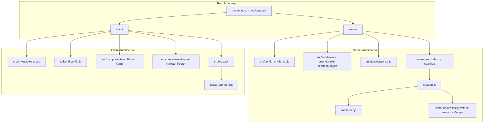

# Phase 1 Foundation Implementation Plan

> **For agentic workers:** REQUIRED SUB-SKILL: Use superpowers:subagent-driven-development to implement this plan task-by-task. Steps use checkbox (`- [ ]`) syntax for tracking.

**Goal:** Scaffold and verify the production-grade monorepo foundation for AI Mystery Room, including npm workspaces, Express API backend with standardized response envelopes and health check, and React/Vite/Tailwind frontend with the Neo-Brutalism design token system.

**Architecture:** The project is organized as an npm monorepo with `client` and `server` workspaces. The backend is an Express application using Mongoose, Helmet, and Zod validation, with a standard JSON envelope middleware. The frontend is a React 19 app bundled with Vite and styled using Tailwind CSS configured with the specific colorful neo-brutalism tokens. Automated testing uses Vitest, Supertest, and in-memory MongoDB.

**Architecture Diagram:**



**Tech Stack:**
- Runtime: Node.js v22
- Backend: Express v4, Mongoose v8, Zod v3, Helmet, CORS, Morgan
- Frontend: React 19, Vite, Tailwind CSS v3, Lucide React
- Testing: Vitest, Supertest, React Testing Library, mongodb-memory-server
- Design System: Neo-brutalism (Space Grotesk, Inter, IBM Plex Mono, hard shadows, ink outlines)

**Spec:** [`docs/superpowers/specs/2026-10-25-phase-1-foundation-design.md`](file:///c:/Users/yuvra/OneDrive/Desktop/AI%20Mystery%20Room/docs/superpowers/specs/2026-10-25-phase-1-foundation-design.md)

## Global Constraints
- Every API response must use the standard envelope (`{ success, data, message, meta }` or `{ success: false, error: { code, message, fields } }`).
- Strictly adhere to `AI_DEVELOPMENT_RULES.md` and `FEATURE_DELIVERY_WORKFLOW.md`.
- No solution leakage or private fields allowed in public API routes.
- Neo-brutalist theme tokens must be defined in CSS variables and mapped into Tailwind.
- All tests must be deterministic and run without live cloud credentials.

---

### Task 1: Monorepo Root Configuration & Tooling

**Files:**
- Create: `package.json`
- Create: `.gitignore`
- Create: `.env.example`

**Interfaces:**
- Consumes: None
- Produces: Root npm workspaces configuration and development scripts (`npm run dev`, `npm test`, `npm run build`, `npm run lint`).

- [ ] **Step 1: Create root `.gitignore`**

```gitignore
node_modules/
dist/
build/
coverage/
.env
.env.local
*.log
.DS_Store
Thumbs.db
```

- [ ] **Step 2: Create root `.env.example`**

```env
PORT=5000
NODE_ENV=development
MONGODB_URI=mongodb://localhost:27017/ai-mystery-room
CLIENT_URL=http://localhost:5173
JWT_SECRET=super_secret_jwt_key_change_in_production
GEMINI_API_KEY=your_gemini_api_key_here
GEMINI_MODEL=gemini-1.5-flash
```

- [ ] **Step 3: Create root `package.json` with npm workspaces**

```json
{
  "name": "ai-mystery-room",
  "version": "1.0.0",
  "private": true,
  "workspaces": [
    "server",
    "client"
  ],
  "scripts": {
    "dev:server": "npm run dev --workspace=server",
    "dev:client": "npm run dev --workspace=client",
    "dev": "npm run dev:server",
    "test:server": "npm test --workspace=server",
    "test:client": "npm test --workspace=client",
    "test": "npm run test:server && npm run test:client",
    "build:client": "npm run build --workspace=client",
    "build": "npm run build:client"
  },
  "keywords": [
    "ai",
    "mystery",
    "neo-brutalism",
    "game"
  ],
  "author": "",
  "license": "ISC"
}
```

- [ ] **Step 4: Commit root configuration**

```bash
git add package.json .gitignore .env.example
git commit -m "chore: initialize monorepo root structure and workspaces"
```

---

### Task 2: Express Server Foundation & Health Endpoint

**Files:**
- Create: `server/package.json`
- Create: `server/src/config/env.js`
- Create: `server/src/config/db.js`
- Create: `server/src/utils/response.js`
- Create: `server/src/middleware/errorHandler.js`
- Create: `server/src/routes/health.js`
- Create: `server/src/routes/index.js`
- Create: `server/src/app.js`
- Create: `server/src/server.js`
- Create: `server/tests/setup.js`
- Create: `server/tests/health.test.js`

**Interfaces:**
- Consumes: Root workspace
- Produces: Express API running on port 5000 (default), standard response helpers, database connection helper, and `/api/v1/health` endpoint.

- [ ] **Step 1: Create `server/package.json`**

```json
{
  "name": "server",
  "version": "1.0.0",
  "type": "module",
  "scripts": {
    "start": "node src/server.js",
    "dev": "node --watch src/server.js",
    "test": "vitest run"
  },
  "dependencies": {
    "cors": "^2.8.5",
    "dotenv": "^16.4.7",
    "express": "^4.21.2",
    "helmet": "^8.0.0",
    "mongoose": "^8.9.5",
    "morgan": "^1.10.0",
    "zod": "^3.24.1"
  },
  "devDependencies": {
    "mongodb-memory-server": "^10.1.3",
    "supertest": "^7.0.0",
    "vitest": "^3.0.4"
  }
}
```

- [ ] **Step 2: Install server dependencies**

Run: `npm install --workspace=server`
Expected: Dependencies installed cleanly.

- [ ] **Step 3: Write the failing health test (`server/tests/health.test.js`)**

```javascript
import { describe, it, expect, beforeAll, afterAll } from 'vitest';
import request from 'supertest';
import app from '../src/app.js';
import { connectTestDb, closeTestDb } from './setup.js';

beforeAll(async () => {
  await connectTestDb();
});

afterAll(async () => {
  await closeTestDb();
});

describe('GET /api/v1/health', () => {
  it('should return 200 with standard response envelope and database status', async () => {
    const res = await request(app).get('/api/v1/health');
    expect(res.status).toBe(200);
    expect(res.body.success).toBe(true);
    expect(res.body.data).toHaveProperty('status', 'healthy');
    expect(res.body.data).toHaveProperty('database');
    expect(res.body.data.database).toBe('connected');
    expect(res.body.data).toHaveProperty('timestamp');
  });

  it('should return 404 with standard error envelope for unknown routes', async () => {
    const res = await request(app).get('/api/v1/unknown-endpoint');
    expect(res.status).toBe(404);
    expect(res.body.success).toBe(false);
    expect(res.body.error).toHaveProperty('code', 'NOT_FOUND');
    expect(res.body.error).toHaveProperty('message');
  });
});
```

- [ ] **Step 4: Create in-memory database helper (`server/tests/setup.js`)**

```javascript
import { MongoMemoryServer } from 'mongodb-memory-server';
import mongoose from 'mongoose';

let mongoServer;

export async function connectTestDb() {
  mongoServer = await MongoMemoryServer.create();
  const uri = mongoServer.getUri();
  await mongoose.connect(uri);
}

export async function closeTestDb() {
  if (mongoose.connection.readyState !== 0) {
    await mongoose.disconnect();
  }
  if (mongoServer) {
    await mongoServer.stop();
  }
}
```

- [ ] **Step 5: Run test to verify failure**

Run: `npm test --workspace=server`
Expected: FAIL (missing `src/app.js`).

- [ ] **Step 6: Implement `server/src/utils/response.js`**

```javascript
export function sendSuccess(res, { data = null, message = 'Request completed successfully', meta = undefined, statusCode = 200 } = {}) {
  const payload = {
    success: true,
    data,
    message,
  };
  if (meta !== undefined) {
    payload.meta = meta;
  }
  return res.status(statusCode).json(payload);
}

export function sendError(res, { code = 'INTERNAL_ERROR', message = 'An unexpected error occurred', statusCode = 500, fields = undefined, requestId = undefined } = {}) {
  const errorObj = {
    code,
    message,
  };
  if (fields !== undefined) {
    errorObj.fields = fields;
  }
  if (requestId !== undefined) {
    errorObj.requestId = requestId;
  }
  return res.status(statusCode).json({
    success: false,
    error: errorObj,
  });
}
```

- [ ] **Step 7: Implement `server/src/config/env.js`**

```javascript
import dotenv from 'dotenv';
import { z } from 'zod';

dotenv.config();

const envSchema = z.object({
  PORT: z.coerce.number().default(5000),
  NODE_ENV: z.enum(['development', 'production', 'test']).default('development'),
  MONGODB_URI: z.string().default('mongodb://localhost:27017/ai-mystery-room'),
  CLIENT_URL: z.string().default('http://localhost:5173'),
  JWT_SECRET: z.string().default('super_secret_jwt_key_change_in_production'),
});

const parsed = envSchema.safeParse(process.env);

if (!parsed.success) {
  console.error('Invalid environment variables:', parsed.error.format());
  process.exit(1);
}

export const env = parsed.data;
```

- [ ] **Step 8: Implement `server/src/config/db.js`**

```javascript
import mongoose from 'mongoose';
import { env } from './env.js';

export async function connectDb(uri = env.MONGODB_URI) {
  try {
    const conn = await mongoose.connect(uri);
    console.log(`MongoDB connected: ${conn.connection.host}`);
    return conn;
  } catch (error) {
    console.error('MongoDB connection error:', error.message);
    throw error;
  }
}

export function isDbConnected() {
  return mongoose.connection.readyState === 1;
}
```

- [ ] **Step 9: Implement `server/src/middleware/errorHandler.js`**

```javascript
import { sendError } from '../utils/response.js';

export function errorHandler(err, req, res, next) {
  console.error('[Error Middleware]:', err);

  if (err.name === 'ZodError') {
    const fields = {};
    for (const issue of err.issues) {
      const path = issue.path.join('.');
      fields[path] = issue.message;
    }
    return sendError(res, {
      code: 'VALIDATION_ERROR',
      message: 'The supplied input is invalid',
      statusCode: 400,
      fields,
    });
  }

  return sendError(res, {
    code: err.code || 'INTERNAL_ERROR',
    message: err.message || 'An unexpected error occurred',
    statusCode: err.statusCode || 500,
  });
}

export function notFoundHandler(req, res) {
  return sendError(res, {
    code: 'NOT_FOUND',
    message: `Cannot ${req.method} ${req.originalUrl}`,
    statusCode: 404,
  });
}
```

- [ ] **Step 10: Implement routes (`health.js` and `index.js`)**

`server/src/routes/health.js`:
```javascript
import { Router } from 'express';
import { sendSuccess } from '../utils/response.js';
import { isDbConnected } from '../config/db.js';

const router = Router();

router.get('/health', (req, res) => {
  return sendSuccess(res, {
    data: {
      status: 'healthy',
      database: isDbConnected() ? 'connected' : 'disconnected',
      uptime: process.uptime(),
      timestamp: new Date().toISOString(),
    },
    message: 'AI Mystery Room API is running',
  });
});

export default router;
```

`server/src/routes/index.js`:
```javascript
import { Router } from 'express';
import healthRouter from './health.js';

const apiRouter = Router();

apiRouter.use(healthRouter);

export default apiRouter;
```

- [ ] **Step 11: Implement `server/src/app.js` and `server/src/server.js`**

`server/src/app.js`:
```javascript
import express from 'express';
import cors from 'cors';
import helmet from 'helmet';
import morgan from 'morgan';
import { env } from './config/env.js';
import apiRouter from './routes/index.js';
import { errorHandler, notFoundHandler } from './middleware/errorHandler.js';

const app = express();

app.use(helmet());
app.use(cors({
  origin: env.CLIENT_URL,
  credentials: true,
}));
app.use(express.json({ limit: '1mb' }));
app.use(express.urlencoded({ extended: true }));

if (env.NODE_ENV !== 'test') {
  app.use(morgan('dev'));
}

app.use('/api/v1', apiRouter);

app.use(notFoundHandler);
app.use(errorHandler);

export default app;
```

`server/src/server.js`:
```javascript
import app from './app.js';
import { env } from './config/env.js';
import { connectDb } from './config/db.js';

async function bootstrap() {
  try {
    await connectDb();
    app.listen(env.PORT, () => {
      console.log(`Server running in ${env.NODE_ENV} mode on http://localhost:${env.PORT}`);
    });
  } catch (error) {
    console.error('Failed to start server:', error.message);
    process.exit(1);
  }
}

bootstrap();
```

- [ ] **Step 12: Run server tests to verify pass**

Run: `npm test --workspace=server`
Expected: 2 passed.

- [ ] **Step 13: Commit server foundation**

```bash
git add server/
git commit -m "feat(server): setup Express foundation with standard response envelopes and health check"
```

---

### Task 3: Client Foundation & Neo-Brutalist Design System

**Files:**
- Create: `client/package.json`
- Create: `client/vite.config.js`
- Create: `client/postcss.config.js`
- Create: `client/tailwind.config.js`
- Create: `client/index.html`
- Create: `client/src/styles/tokens.css`
- Create: `client/src/styles/index.css`
- Create: `client/src/components/ui/Button.jsx`
- Create: `client/src/components/ui/Card.jsx`
- Create: `client/src/components/layout/Navbar.jsx`
- Create: `client/src/components/layout/Footer.jsx`
- Create: `client/src/App.jsx`
- Create: `client/src/main.jsx`
- Create: `client/tests/setup.js`
- Create: `client/tests/App.test.jsx`

**Interfaces:**
- Consumes: Server API `/api/v1` via Vite proxy
- Produces: React application with Neo-Brutalist design tokens (`bg-paper`, `text-ink`, `border-ink`, `shadow-hard-md`, `Button`, `Card`).

- [ ] **Step 1: Create `client/package.json`**

```json
{
  "name": "client",
  "version": "1.0.0",
  "type": "module",
  "scripts": {
    "dev": "vite",
    "build": "vite build",
    "preview": "vite preview",
    "test": "vitest run"
  },
  "dependencies": {
    "clsx": "^2.1.1",
    "lucide-react": "^0.474.0",
    "react": "^19.0.0",
    "react-dom": "^19.0.0",
    "tailwind-merge": "^3.0.1"
  },
  "devDependencies": {
    "@testing-library/jest-dom": "^6.6.3",
    "@testing-library/react": "^16.2.0",
    "@vitejs/plugin-react": "^4.3.4",
    "autoprefixer": "^10.4.20",
    "jsdom": "^26.0.0",
    "postcss": "^8.5.1",
    "tailwindcss": "^3.4.17",
    "vite": "^6.0.11",
    "vitest": "^3.0.4"
  }
}
```

- [ ] **Step 2: Install client dependencies**

Run: `npm install --workspace=client`
Expected: Dependencies installed cleanly.

- [ ] **Step 3: Create `client/vite.config.js`**

```javascript
import { defineConfig } from 'vite';
import react from '@vitejs/plugin-react';

export default defineConfig({
  plugins: [react()],
  server: {
    port: 5173,
    proxy: {
      '/api': {
        target: 'http://localhost:5000',
        changeOrigin: true,
      },
    },
  },
  test: {
    environment: 'jsdom',
    setupFiles: './tests/setup.js',
    globals: true,
  },
});
```

- [ ] **Step 4: Create `client/postcss.config.js`**

```javascript
export default {
  plugins: {
    tailwindcss: {},
    autoprefixer: {},
  },
};
```

- [ ] **Step 5: Create `client/src/styles/tokens.css`**

```css
:root {
  --color-ink: #191919;
  --color-paper: #FFF9EE;
  --color-white: #FFFFFF;
  --color-muted: #68645F;
  --color-line: #191919;
  
  --color-yellow: #FFE45E;
  --color-pink: #FF78B7;
  --color-coral: #FF6B57;
  --color-blue: #75C9FF;
  --color-green: #8DE0A1;
  --color-purple: #B5A0FF;
  --color-orange: #FFB454;

  --color-success: #247A45;
  --color-success-bg: #D9F7DF;
  --color-warning: #8A4B00;
  --color-warning-bg: #FFF0C7;
  --color-danger: #B42318;
  --color-danger-bg: #FFE1DE;
  --color-info: #075985;
  --color-info-bg: #DDF3FF;

  --shadow-hard-sm: 3px 3px 0 var(--color-ink);
  --shadow-hard-md: 5px 5px 0 var(--color-ink);
  --shadow-hard-lg: 8px 8px 0 var(--color-ink);
  --shadow-hard-hover: 2px 2px 0 var(--color-ink);
}
```

- [ ] **Step 6: Configure `client/tailwind.config.js`**

```javascript
/** @type {import('tailwindcss').Config} */
export default {
  content: [
    "./index.html",
    "./src/**/*.{js,ts,jsx,tsx}",
  ],
  theme: {
    extend: {
      colors: {
        ink: 'var(--color-ink)',
        paper: 'var(--color-paper)',
        muted: 'var(--color-muted)',
        neoYellow: 'var(--color-yellow)',
        neoPink: 'var(--color-pink)',
        neoCoral: 'var(--color-coral)',
        neoBlue: 'var(--color-blue)',
        neoGreen: 'var(--color-green)',
        neoPurple: 'var(--color-purple)',
        neoOrange: 'var(--color-orange)',
        danger: 'var(--color-danger)',
        dangerBg: 'var(--color-danger-bg)',
      },
      fontFamily: {
        display: ['"Space Grotesk"', 'sans-serif'],
        sans: ['Inter', 'sans-serif'],
        mono: ['"IBM Plex Mono"', 'monospace'],
      },
      boxShadow: {
        'hard-sm': 'var(--shadow-hard-sm)',
        'hard-md': 'var(--shadow-hard-md)',
        'hard-lg': 'var(--shadow-hard-lg)',
        'hard-hover': 'var(--shadow-hard-hover)',
      },
      borderWidth: {
        3: '3px',
      },
    },
  },
  plugins: [],
};
```

- [ ] **Step 7: Configure `client/src/styles/index.css` and `client/index.html`**

`client/src/styles/index.css`:
```css
@import './tokens.css';
@tailwind base;
@tailwind components;
@tailwind utilities;

body {
  background-color: var(--color-paper);
  color: var(--color-ink);
  font-family: 'Inter', sans-serif;
  margin: 0;
  min-height: 100vh;
}
```

`client/index.html`:
```html
<!doctype html>
<html lang="en">
  <head>
    <meta charset="UTF-8" />
    <link rel="icon" type="image/svg+xml" href="/vite.svg" />
    <meta name="viewport" content="width=device-width, initial-scale=1.0" />
    <link rel="preconnect" href="https://fonts.googleapis.com">
    <link rel="preconnect" href="https://fonts.gstatic.com" crossorigin>
    <link href="https://fonts.googleapis.com/css2?family=IBM+Plex+Mono:wght@400;500;600&family=Inter:wght@400;500;600;700&family=Space+Grotesk:wght@600;700;800&display=swap" rel="stylesheet">
    <title>AI Mystery Room — Interactive Detective Cases</title>
  </head>
  <body>
    <div id="root"></div>
    <script type="module" src="/src/main.jsx"></script>
  </body>
</html>
```

- [ ] **Step 8: Implement UI Components (`Button.jsx`, `Card.jsx`, `Navbar.jsx`, `Footer.jsx`)**

`client/src/components/ui/Button.jsx`:
```jsx
import React from 'react';

const variants = {
  primary: 'bg-neoYellow text-ink hover:translate-x-[1px] hover:translate-y-[1px] hover:shadow-hard-hover active:translate-x-[3px] active:translate-y-[3px] active:shadow-none',
  secondary: 'bg-white text-ink hover:translate-x-[1px] hover:translate-y-[1px] hover:shadow-hard-hover active:translate-x-[3px] active:translate-y-[3px] active:shadow-none',
  accent: 'bg-neoPurple text-ink hover:translate-x-[1px] hover:translate-y-[1px] hover:shadow-hard-hover active:translate-x-[3px] active:translate-y-[3px] active:shadow-none',
  danger: 'bg-neoCoral text-ink hover:translate-x-[1px] hover:translate-y-[1px] hover:shadow-hard-hover active:translate-x-[3px] active:translate-y-[3px] active:shadow-none',
  ghost: 'bg-transparent text-ink border-transparent shadow-none hover:bg-black/5',
};

const sizes = {
  sm: 'px-3 py-1.5 text-sm',
  md: 'px-5 py-2.5 text-base',
  lg: 'px-7 py-3.5 text-lg font-bold',
};

export function Button({
  children,
  variant = 'primary',
  size = 'md',
  className = '',
  disabled = false,
  ...props
}) {
  return (
    <button
      disabled={disabled}
      className={`inline-flex items-center justify-center font-display font-bold border-2 border-ink rounded-lg shadow-hard-md transition-all duration-150 disabled:opacity-50 disabled:pointer-events-none ${variants[variant]} ${sizes[size]} ${className}`}
      {...props}
    >
      {children}
    </button>
  );
}
```

`client/src/components/ui/Card.jsx`:
```jsx
import React from 'react';

export function Card({
  children,
  className = '',
  accent = 'white',
  interactive = false,
  ...props
}) {
  const accentBgs = {
    white: 'bg-white',
    paper: 'bg-paper',
    yellow: 'bg-neoYellow',
    purple: 'bg-neoPurple',
    blue: 'bg-neoBlue',
    pink: 'bg-neoPink',
    coral: 'bg-neoCoral',
  };

  return (
    <div
      className={`border-2 border-ink rounded-xl shadow-hard-md p-6 ${accentBgs[accent] || 'bg-white'} ${interactive ? 'transition-all duration-150 hover:-translate-y-0.5 hover:shadow-hard-lg' : ''} ${className}`}
      {...props}
    >
      {children}
    </div>
  );
}
```

`client/src/components/layout/Navbar.jsx`:
```jsx
import React from 'react';
import { Search, Compass } from 'lucide-react';
import { Button } from '../ui/Button';

export function Navbar() {
  return (
    <header className="border-b-2 border-ink bg-paper sticky top-0 z-50">
      <div className="max-w-7xl mx-auto px-4 sm:px-6 lg:px-8 h-18 flex items-center justify-between">
        <div className="flex items-center gap-3">
          <div className="w-10 h-10 bg-neoYellow border-2 border-ink rounded-lg flex items-center justify-center shadow-hard-sm">
            <Search className="w-6 h-6 text-ink stroke-[2.5]" />
          </div>
          <span className="font-display font-extrabold text-2xl tracking-tight text-ink uppercase">
            AI Mystery Room
          </span>
        </div>

        <nav className="hidden md:flex items-center gap-6 font-display font-bold text-sm">
          <a href="#how-it-works" className="hover:text-neoPurple transition-colors">HOW IT WORKS</a>
          <a href="#sample-case" className="hover:text-neoPurple transition-colors">SAMPLE CASE</a>
          <Button variant="primary" size="sm">
            <Compass className="w-4 h-4 mr-2 stroke-[2.5]" />
            START INVESTIGATING
          </Button>
        </nav>
      </div>
    </header>
  );
}
```

`client/src/components/layout/Footer.jsx`:
```jsx
import React from 'react';

export function Footer() {
  return (
    <footer className="border-t-2 border-ink bg-paper py-8 mt-auto">
      <div className="max-w-7xl mx-auto px-4 text-center font-mono text-sm text-muted">
        <p className="font-display font-bold text-ink uppercase">AI Mystery Room &copy; {new Date().getFullYear()}</p>
        <p className="mt-1">AI creates the mystery. The backend preserves the truth. You discover it.</p>
      </div>
    </footer>
  );
}
```

- [ ] **Step 9: Create `client/src/App.jsx` and `client/src/main.jsx`**

`client/src/App.jsx`:
```jsx
import React, { useEffect, useState } from 'react';
import { Navbar } from './components/layout/Navbar';
import { Footer } from './components/layout/Footer';
import { Card } from './components/ui/Card';
import { Button } from './components/ui/Button';
import { ShieldCheck, Sparkles, FolderArchive, HelpCircle } from 'lucide-react';

export default function App() {
  const [apiHealth, setApiHealth] = useState({ status: 'checking', message: 'Connecting to API...' });

  useEffect(() => {
    fetch('/api/v1/health')
      .then((res) => res.json())
      .then((data) => {
        if (data.success) {
          setApiHealth({ status: 'connected', message: data.message, database: data.data.database });
        } else {
          setApiHealth({ status: 'error', message: 'API returned error envelope' });
        }
      })
      .catch((err) => {
        setApiHealth({ status: 'offline', message: `API offline or proxy error: ${err.message}` });
      });
  }, []);

  return (
    <div className="min-h-screen flex flex-col bg-paper text-ink">
      <Navbar />

      <main className="max-w-7xl mx-auto px-4 sm:px-6 lg:px-8 py-12 flex-1">
        {/* Hero Section */}
        <div className="grid grid-cols-1 lg:grid-cols-12 gap-8 items-center mb-16">
          <div className="lg:col-span-7 space-y-6">
            <div className="inline-flex items-center gap-2 px-3 py-1 bg-neoPink border-2 border-ink rounded-full text-xs font-mono font-bold shadow-hard-sm">
              <Sparkles className="w-3.5 h-3.5" />
              FICTIONAL INVESTIGATION PLATFORM
            </div>

            <h1 className="font-display font-extrabold text-4xl sm:text-5xl lg:text-6xl text-ink leading-tight">
              CRACK THE CODE.<br />
              <span className="bg-neoYellow px-2 border-2 border-ink shadow-hard-sm inline-block mt-1">
                UNMASK THE CULPRIT.
              </span>
            </h1>

            <p className="text-lg text-ink font-medium max-w-xl">
              Turn any scenario or premise into an interactive detective dossier. Examine suspect alibis, surveillance stills, forensic logs, and chats.
            </p>

            <div className="flex flex-wrap gap-4 pt-2">
              <Button variant="primary" size="lg">START AN INVESTIGATION</Button>
              <Button variant="secondary" size="lg">EXPLORE SAMPLE CASE</Button>
            </div>
          </div>

          <div className="lg:col-span-5">
            <Card accent="purple" className="rotate-1 hover:rotate-0 transition-transform">
              <div className="flex items-center justify-between border-b-2 border-ink pb-3 mb-4">
                <span className="font-mono font-bold text-xs bg-neoYellow px-2 py-0.5 border border-ink rounded">
                  CASE-2026-X89
                </span>
                <span className="font-mono text-xs font-semibold">DIFFICULTY: MEDIUM</span>
              </div>
              <h3 className="font-display font-bold text-2xl mb-2">The Curator's Vanishing</h3>
              <p className="text-sm font-medium mb-4 text-ink">
                A rare masterpiece disappears from the modern gallery vault during the midnight gala. Four suspects with conflicting alibis.
              </p>
              <div className="grid grid-cols-2 gap-2 text-xs font-mono font-semibold">
                <div className="bg-white p-2 border border-ink rounded">4 SUSPECTS</div>
                <div className="bg-white p-2 border border-ink rounded">9 CLUES</div>
              </div>
            </Card>
          </div>
        </div>

        {/* Phase 1 Verification / Status Strip */}
        <section className="mt-8 border-t-2 border-ink pt-8">
          <div className="flex items-center gap-3 mb-6">
            <ShieldCheck className="w-6 h-6 text-neoGreen stroke-[2.5]" />
            <h2 className="font-display font-bold text-2xl">Phase 1 Foundation Verification</h2>
          </div>

          <div className="grid grid-cols-1 md:grid-cols-3 gap-6">
            <Card accent="white">
              <h3 className="font-display font-bold text-lg mb-2 flex items-center gap-2">
                <FolderArchive className="w-5 h-5 text-neoBlue" />
                Monorepo Workspaces
              </h3>
              <p className="text-sm text-muted">
                Cleanly decoupled client and server workspaces with shared npm scripts.
              </p>
              <span className="inline-block mt-4 font-mono text-xs font-bold bg-neoGreen px-2 py-1 border border-ink rounded">
                CONFIGURED
              </span>
            </Card>

            <Card accent="white">
              <h3 className="font-display font-bold text-lg mb-2 flex items-center gap-2">
                <Sparkles className="w-5 h-5 text-neoYellow" />
                Neo-Brutalist Theme
              </h3>
              <p className="text-sm text-muted">
                Design system tokens, custom font scale, and 5px hard offset ink shadows.
              </p>
              <span className="inline-block mt-4 font-mono text-xs font-bold bg-neoGreen px-2 py-1 border border-ink rounded">
                VERIFIED
              </span>
            </Card>

            <Card accent="white">
              <h3 className="font-display font-bold text-lg mb-2 flex items-center gap-2">
                <HelpCircle className="w-5 h-5 text-neoPurple" />
                API Health Link
              </h3>
              <p className="text-sm text-muted font-mono">
                Status: {apiHealth.status.toUpperCase()}
              </p>
              <span className={`inline-block mt-4 font-mono text-xs font-bold px-2 py-1 border border-ink rounded ${apiHealth.status === 'connected' ? 'bg-neoGreen' : 'bg-neoYellow'}`}>
                {apiHealth.message}
              </span>
            </Card>
          </div>
        </section>
      </main>

      <Footer />
    </div>
  );
}
```

`client/src/main.jsx`:
```jsx
import React from 'react';
import ReactDOM from 'react-dom/client';
import App from './App.jsx';
import './styles/index.css';

ReactDOM.createRoot(document.getElementById('root')).render(
  <React.StrictMode>
    <App />
  </React.StrictMode>
);
```

- [ ] **Step 10: Create client test setup and App component test**

`client/tests/setup.js`:
```javascript
import '@testing-library/jest-dom';
```

`client/tests/App.test.jsx`:
```jsx
import { describe, it, expect, vi } from 'vitest';
import { render, screen } from '@testing-library/react';
import App from '../src/App';

global.fetch = vi.fn(() =>
  Promise.resolve({
    json: () => Promise.resolve({ success: true, message: 'API running', data: { database: 'connected' } }),
  })
);

describe('App Component', () => {
  it('renders brand wordmark and hero title', () => {
    render(<App />);
    expect(screen.getByText(/AI MYSTERY ROOM/i)).toBeInTheDocument();
    expect(screen.getByText(/CRACK THE CODE/i)).toBeInTheDocument();
    expect(screen.getByText(/START AN INVESTIGATION/i)).toBeInTheDocument();
  });

  it('renders Neo-Brutalist UI cards and foundation status', () => {
    render(<App />);
    expect(screen.getByText(/Phase 1 Foundation Verification/i)).toBeInTheDocument();
    expect(screen.getByText(/Monorepo Workspaces/i)).toBeInTheDocument();
  });
});
```

- [ ] **Step 11: Run client tests to verify pass**

Run: `npm test --workspace=client`
Expected: 2 passed.

- [ ] **Step 12: Verify client production build**

Run: `npm run build --workspace=client`
Expected: `vite build` completed successfully without errors.

- [ ] **Step 13: Commit client foundation**

```bash
git add client/
git commit -m "feat(client): setup React, Tailwind neo-brutalist theme, and core UI primitives"
```

---

### Task 4: Full-Stack Verification & Milestone Completion

**Files:**
- Modify: `package.json` (if any script tweaks needed)

**Interfaces:**
- Consumes: Server and Client workspaces
- Produces: Complete passing test suite and verifiable local execution.

- [ ] **Step 1: Run complete monorepo test suite from root**

Run: `npm test`
Expected: All server and client tests pass (exit code 0).

- [ ] **Step 2: Test both servers running together**

Run: `npm run build`
Expected: Build passes cleanly.

- [ ] **Step 3: Commit Phase 1 completion milestone**

```bash
git add -A
git commit -m "feat: complete Phase 1 Foundation milestone for AI Mystery Room"
```
