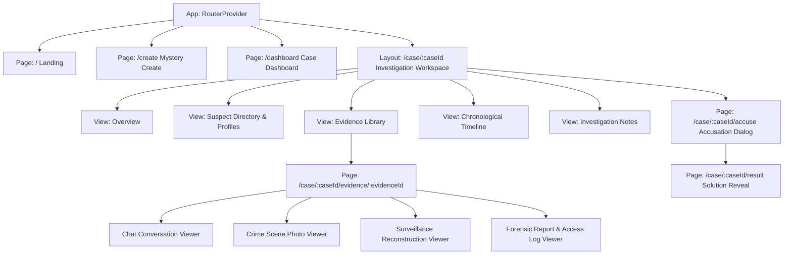

# Phase 2 Core UI Implementation Plan

> **For agentic workers:** REQUIRED SUB-SKILL: Use superpowers:subagent-driven-development to implement this plan task-by-task. Steps use checkbox (`- [ ]`) syntax for tracking.

**Goal:** Build the complete interactive frontend UI for AI Mystery Room with React Router, deterministic case fixtures, Landing Page, Mystery Creation flow, User Dashboard, Investigation Workspace (suspect directory, evidence library, timeline, notes), type-specific Evidence Viewers (chat, image, surveillance, forensic document), Accusation Flow with confirmation modal, and Solution Reveal.

**Architecture:** Client-side routing with `react-router-dom` v7/v6 connecting all specified routes. State management for local investigation progress, notes, and accusations backed by a comprehensive fixture database (`client/src/data/sampleCase.js`) adhering strictly to the public/private boundary specified in `Docs/specs.md` and `Docs/DESIGN_SPEC.md`.

**Architecture Diagram:**



**Tech Stack:**
- React 19, Vite, Tailwind CSS v3
- `react-router-dom` v7
- `lucide-react` icons
- Vitest, React Testing Library
- Design Tokens: Neo-Brutalism (Space Grotesk, Inter, IBM Plex Mono, hard shadows `5px 5px 0 #191919`, 2px ink borders, yellow/pink/blue/purple/coral palette)

**Spec:** [`Docs/specs.md`](file:///c:/Users/yuvra/OneDrive/Desktop/AI%20Mystery%20Room/Docs/specs.md), [`Docs/DESIGN_SPEC.md`](file:///c:/Users/yuvra/OneDrive/Desktop/AI%20Mystery%20Room/Docs/DESIGN_SPEC.md), [`Docs/USER_FLOWS.md`](file:///c:/Users/yuvra/OneDrive/Desktop/AI%20Mystery%20Room/Docs/USER_FLOWS.md)

## Global Constraints
- Absolute non-disclosure: pre-completion views, props, or client state must NEVER contain the canonical culprit or private solution rationale.
- Neo-brutalist styling rules: 2px solid ink borders, 5px hard offset shadows, vibrant semantic accents, Space Grotesk headings, Inter body, IBM Plex Mono identifiers.
- Accusation submission must require explicit selection, open a confirmation dialog explaining finality, and determine correctness deterministically.
- All primary user flows must be responsive down to 360px without horizontal overflow.

---

### Task 1: Router Setup & Sample Case Fixture Architecture

**Files:**
- Modify: `client/package.json`
- Create: `client/src/data/sampleCase.js`
- Create: `client/src/context/InvestigationContext.jsx`
- Modify: `client/src/App.jsx`
- Test: `client/tests/router.test.jsx`

**Interfaces:**
- Consumes: `react-router-dom`, existing UI primitives (`Button`, `Card`, `Navbar`, `Footer`)
- Produces: `InvestigationProvider`, structured sample case fixture, base route mapping for all pages.

- [ ] **Step 1: Install `react-router-dom` in client**

Run: `npm install react-router-dom --workspace=client`
Expected: `react-router-dom` installed cleanly.

- [ ] **Step 2: Create `client/src/data/sampleCase.js`**

Implement canonical sample case `case_midnight_gallery_01` ("The Gallery After Midnight"):
- 4 suspects: Alex Morgan (Curator), Elena Vance (Security Officer), Julian Ross (Art Restorer), Marcus Sterling (Patron).
- Incident: Missing painting "The Midnight Reverie", occurred at 2030-01-01T21:30:00Z.
- 6 diverse evidence items:
  1. `evidence_chat_01`: Fictional WhatsApp messages between Elena and Julian discussing disabled vault sensors.
  2. `evidence_img_01`: Photo of cut glass frame on the gallery floor.
  3. `evidence_surv_01`: Camera 04 reconstruction log with timestamped stills.
  4. `evidence_log_01`: Keycard access log showing badge swipe discrepancy.
  5. `evidence_forensic_01`: Trace analysis finding synthetic solvent residue.
  6. `evidence_statement_01`: Witness statement from the evening janitor.
- Timeline with 5 chronological events.
- Private solution (isolated and used only in post-accusation verification): Culprit is Julian Ross.

- [ ] **Step 3: Create `client/src/context/InvestigationContext.jsx`**

Provide investigation state:
- `currentCase`: active case data (public fields only).
- `progress`: `openedEvidenceIds`, `notes`, `status` ('active' | 'completed').
- `actions`: `openEvidence(id)`, `updateNotes(text)`, `submitAccusation(suspectId, reasoning)`.
- `result`: solution reveal data unlocked only upon accusation completion.

- [ ] **Step 4: Write router and context test (`client/tests/router.test.jsx`)**

Verify:
- Default route (`/`) renders landing page.
- Context initializes with sample case.
- `/dashboard` renders dashboard view.
- `/create` renders creation view.

- [ ] **Step 5: Run test to verify pass**

Run: `npm test --workspace=client`
Expected: All tests pass.

- [ ] **Step 6: Commit Task 1**

```bash
git add client/
git commit -m "feat(client): setup React Router, sample case fixture, and investigation context"
```

---

### Task 2: Landing Page & Mystery Creation Flow

**Files:**
- Create: `client/src/pages/LandingPage.jsx`
- Create: `client/src/pages/CreateMysteryPage.jsx`
- Create: `client/src/components/landing/HowItWorks.jsx`
- Create: `client/src/components/landing/FeatureGrid.jsx`
- Create: `client/src/components/landing/SampleCaseCard.jsx`
- Test: `client/tests/CreateMystery.test.jsx`

**Interfaces:**
- Consumes: `InvestigationContext`, UI primitives (`Button`, `Card`, `Navbar`, `Footer`)
- Produces: Full marketing landing page at `/` and mystery creation form at `/create`.

- [ ] **Step 1: Write Create Mystery test (`client/tests/CreateMystery.test.jsx`)**

Test validation rules:
- Empty prompt shows validation error.
- Minimum 20 characters enforced.
- Difficulty selector updates active state.
- Category selector updates active state.
- Preset chip populates textarea.
- Submit transitions to loading generation state, then navigates to investigation room.

- [ ] **Step 2: Implement Landing Page components**

- `client/src/components/landing/HowItWorks.jsx`: 3-step numbered cards (1. Pick Premise, 2. Inspect Dossier, 3. Unmask Culprit).
- `client/src/components/landing/FeatureGrid.jsx`: 4 feature cards (Forensic Logs, Message Extraction, Surveillance Stills, Deterministic Logic).
- `client/src/components/landing/SampleCaseCard.jsx`: Interactive preview card for "The Gallery After Midnight".
- `client/src/pages/LandingPage.jsx`: Hero, features, sample case, and closing CTA.

- [ ] **Step 3: Implement `client/src/pages/CreateMysteryPage.jsx`**

Features:
- Scenario textarea with real-time character counter (`min: 20`, `max: 2000`).
- Quick-pick scenario prompt chips.
- Difficulty picker: Easy (3 suspects), Medium (4 suspects), Hard (5-6 suspects).
- Category picker: Theft, Murder, Disappearance, Corporate Espionage, Cybercrime, Blackmail.
- Length picker: Short, Standard, Extended.
- Animated neo-brutalist generation loader.

- [ ] **Step 4: Run tests**

Run: `npm test --workspace=client`
Expected: Tests pass.

- [ ] **Step 5: Commit Task 2**

```bash
git add client/
git commit -m "feat(client): implement comprehensive landing page and mystery creation flow"
```

---

### Task 3: Dashboard & Case Management (`/dashboard`)

**Files:**
- Create: `client/src/pages/DashboardPage.jsx`
- Create: `client/src/components/dashboard/CaseCard.jsx`
- Create: `client/src/components/dashboard/DeleteCaseModal.jsx`
- Test: `client/tests/Dashboard.test.jsx`

**Interfaces:**
- Consumes: `InvestigationContext`
- Produces: Case overview dashboard at `/dashboard` with active/completed filters and case resume/review actions.

- [ ] **Step 1: Write Dashboard test (`client/tests/Dashboard.test.jsx`)**

Verify:
- Active cases display resume button.
- Completed cases display review solution button.
- Status filter switches between All, Active, and Completed.
- Delete modal opens with confirmation warning.

- [ ] **Step 2: Implement `CaseCard.jsx` and `DeleteCaseModal.jsx`**

- `CaseCard`: Neo-brutalist card with case code badge, difficulty tag, progress bar, and primary action.
- `DeleteCaseModal`: Accessible dialog asking for confirmation before deleting.

- [ ] **Step 3: Implement `DashboardPage.jsx`**

- Header with "New Investigation" CTA.
- Statistics summary strip (Active Cases, Solved Mysteries, Success Rate).
- Filterable case list.

- [ ] **Step 4: Run tests and commit**

Run: `npm test --workspace=client`
Commit: `feat(client): implement dashboard and case management page`

---

### Task 4: Detective Investigation Workspace (`/case/:caseId`)

**Files:**
- Create: `client/src/layouts/InvestigationLayout.jsx`
- Create: `client/src/pages/investigation/CaseOverviewView.jsx`
- Create: `client/src/pages/investigation/SuspectsView.jsx`
- Create: `client/src/pages/investigation/SuspectProfileModal.jsx`
- Create: `client/src/pages/investigation/EvidenceView.jsx`
- Create: `client/src/pages/investigation/TimelineView.jsx`
- Create: `client/src/pages/investigation/NotesView.jsx`
- Test: `client/tests/InvestigationWorkspace.test.jsx`

**Interfaces:**
- Consumes: `InvestigationContext`
- Produces: 3-region investigative desktop shell and mobile bottom-nav layout.

- [ ] **Step 1: Write Investigation Workspace test (`client/tests/InvestigationWorkspace.test.jsx`)**

Verify:
- Navigation between Overview, Suspects, Evidence, Timeline, and Notes preserves state.
- Clicking a suspect opens their detailed alibi profile.
- Updating notes triggers saving/saved indicators.
- Private solution data is not rendered anywhere in workspace.

- [ ] **Step 2: Implement `InvestigationLayout.jsx`**

- Top bar with return link, case title, case code badge, progress percentage pill, and "Accuse" CTA button.
- Left rail with icon-based section switcher.
- Responsive mobile drawer navigation.

- [ ] **Step 3: Implement Workspace Views**

- `CaseOverviewView.jsx`: Public incident summary, fictional location, timeline preview, quick links.
- `SuspectsView.jsx`: Suspect cards with portraits, occupations, and alibis.
- `SuspectProfileModal.jsx`: Modal showing suspect background, alibi statement, and linked evidence items.
- `TimelineView.jsx`: Chronological event sequence with timestamp badges and evidence links.
- `NotesView.jsx`: Detective scratchpad with debounced persistence indicator ("Saving...", "Saved").

- [ ] **Step 4: Run tests and commit**

Run: `npm test --workspace=client`
Commit: `feat(client): implement investigation workspace layout and views`

---

### Task 5: Type-Specific Evidence Viewers (`/case/:caseId/evidence/:evidenceId`)

**Files:**
- Create: `client/src/pages/evidence/EvidenceViewerPage.jsx`
- Create: `client/src/components/evidence/ChatEvidenceViewer.jsx`
- Create: `client/src/components/evidence/ImageEvidenceViewer.jsx`
- Create: `client/src/components/evidence/SurveillanceEvidenceViewer.jsx`
- Create: `client/src/components/evidence/DocumentEvidenceViewer.jsx`
- Test: `client/tests/EvidenceViewers.test.jsx`

**Interfaces:**
- Consumes: Evidence ID from URL params & `InvestigationContext`
- Produces: Full-screen investigative evidence examination suite.

- [ ] **Step 1: Write Evidence Viewers test (`client/tests/EvidenceViewers.test.jsx`)**

Verify:
- Chat viewer renders message bubbles by participant and timestamps.
- Image viewer renders photo container with zoom and fallback.
- Surveillance viewer renders camera reconstruction observations.
- Document viewer renders formatted report sections and access logs.
- Opening evidence marks it as reviewed in investigation context.

- [ ] **Step 2: Implement Shared Viewer Shell (`EvidenceViewerPage.jsx`)**

- Top bar with back to dossier link, evidence title, evidence code badge, and acquisition timestamp.
- Main artifact display area.
- Sidebar inspector with related suspects, related timeline events, and notes shortcut.

- [ ] **Step 3: Implement Type-Specific Artifact Viewers**

- `ChatEvidenceViewer.jsx`: Messaging app styling, speaker alignment, delivery status, timestamp separators.
- `ImageEvidenceViewer.jsx`: Photo frame, magnification toggle, caption, metadata.
- `SurveillanceEvidenceViewer.jsx`: "Simulated Surveillance Reconstruction", camera identifier, timestamp log, still frame viewer.
- `DocumentEvidenceViewer.jsx`: Official police/forensic memorandum styling with access swipe logs and laboratory findings.

- [ ] **Step 4: Run tests and commit**

Run: `npm test --workspace=client`
Commit: `feat(client): implement type-specific evidence viewers for chat, image, surveillance, and documents`

---

### Task 6: Final Accusation Flow & Solution Reveal (`/case/:caseId/accuse` & `/case/:caseId/result`)

**Files:**
- Create: `client/src/pages/AccusationPage.jsx`
- Create: `client/src/components/accusation/AccusationConfirmModal.jsx`
- Create: `client/src/pages/ResultRevealPage.jsx`
- Modify: `client/src/App.jsx`
- Test: `client/tests/AccusationFlow.test.jsx`

**Interfaces:**
- Consumes: `InvestigationContext`
- Produces: Accusation submission flow and comprehensive post-completion solution reveal.

- [ ] **Step 1: Write Accusation & Reveal test (`client/tests/AccusationFlow.test.jsx`)**

Verify:
- Accusation button disabled until suspect selected.
- Submitting opens confirmation dialog warning of permanent lock.
- Correct accusation reveals green victory banner and decisive clues.
- Incorrect accusation reveals coral explanation and actual culprit.
- Solution reveal links back to decisive evidence items.

- [ ] **Step 2: Implement `AccusationPage.jsx` and `AccusationConfirmModal.jsx`**

- Suspect radio cards with photos and alibi summaries.
- Written reasoning textarea.
- Neo-brutalist modal requiring explicit confirmation.

- [ ] **Step 3: Implement `ResultRevealPage.jsx`**

- Result banner with icon and bold verdict.
- Actual culprit dossier card with motive and method explanation.
- Decisive evidence breakdown (why this clue proved guilt).
- Red-herring analysis (why false leads appeared suspicious).
- "Return to Dashboard" and "Solve Another Mystery" buttons.

- [ ] **Step 4: Run full client test suite and production build**

Run: `npm test`
Run: `npm run build`
Expected: All tests pass, build succeeds.

- [ ] **Step 5: Commit Task 6 & Phase 2 completion**

```bash
git add client/
git commit -m "feat(client): implement final accusation flow and solution reveal, completing Phase 2 Core UI"
```
