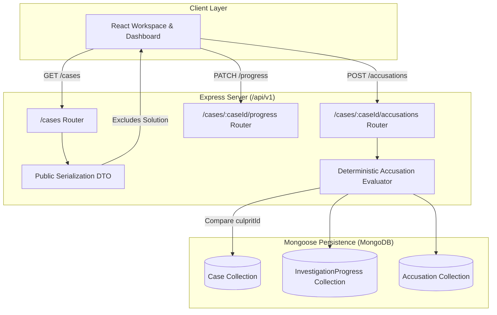

# Phase 3: Server Data Persistence & REST API Implementation Plan

> **For agentic workers:** REQUIRED SUB-SKILL: Use superpowers:subagent-driven-development to implement this plan task-by-task. Steps use checkbox (`- [ ]`) syntax for tracking.

**Goal:** Implement robust server-side Mongoose persistence, security-hardened public/private boundary serialization, REST API routes for case lifecycle & progress tracking, and server-authoritative deterministic accusation evaluation.

**Architecture:** Mongoose models with strict type validation, dedicated serialization DTOs separating public case dossiers from isolated canonical solutions, Express route handlers with standardized response envelopes (`sendSuccess`, `sendError`), and server-authoritative win/loss computation without client trust.

**Architecture Diagram:**



**Tech Stack:** Node.js, Express, Mongoose ODM, MongoDB Memory Server (testing), Supertest, Vitest, Zod.

**Spec References:**
- `Docs/DATA_MODEL.md` (authoritative schema & indexes)
- `Docs/API.md` (authoritative REST contracts & response envelopes)
- `Docs/AI_DEVELOPMENT_RULES.md` (private solution security boundary & server-authoritative evaluation)

---

## Global Constraints

- **Public/Private Boundary:** The canonical solution (`culpritId`, `motive`, `method`, `rationale`, `decisiveEvidenceIds`, `redHerrings`) must NEVER be returned by pre-completion endpoints (`/cases`, `/cases/:id`, `/cases/:id/suspects`, `/cases/:id/evidence`).
- **Server-Authoritative Evaluation:** Accusation correctness and score (100 or 0) must be evaluated deterministically on the server by comparing `suspectId === case.solution.culpritId`.
- **Response Format:** All JSON endpoints must use the standard envelope (`sendSuccess` with `success: true, data: ...` and `sendError` with `success: false, error: { code, message, fields }`).
- **TDD:** Every task must implement automated tests verifying both success states and boundary error handling before marking complete.

---

### Task 1: Mongoose Models & Public Serialization DTOs

**Files:**
- Create: `server/src/models/Case.js`
- Create: `server/src/models/InvestigationProgress.js`
- Create: `server/src/models/Accusation.js`
- Create: `server/src/serializers/caseSerializer.js`
- Test: `server/tests/caseModel.test.js`

**Interfaces:**
- Consumes: Mongoose schema definitions from `Docs/DATA_MODEL.md`
- Produces: `Case`, `InvestigationProgress`, and `Accusation` models with `serializePublicCase(caseDoc)` DTO.

- [ ] **Step 1: Write model & serialization test (`server/tests/caseModel.test.js`)**

Test requirements:
- Creating a valid case persists successfully in MongoDB.
- `serializePublicCase()` strips the `solution` object and all internal private fields.
- Missing required fields (title, summary, category, difficulty) fail validation.
- Validates suspect and evidence subdocuments.

- [ ] **Step 2: Implement `Case.js`**

Schema elements from `Docs/DATA_MODEL.md`:
- `title`, `prompt`, `category`, `difficulty`, `length`, `status`, `summary`.
- `incident`: `{ description, location, occurredAt, timeDescription }`.
- `suspects`: Array of `{ id, name, occupation, relationship, summary, background, publicStatement, alibiPublicText, relatedEvidenceIds, relatedEventIds }`.
- `timeline`: Array of `{ id, timeDescription, occurredAt, description, relatedSuspectIds, relatedEvidenceIds, displayOrder }`.
- `evidence`: Array of `{ id, type, title, description, occurredAt, timeDescription, sourceContext, content, relatedSuspectIds, relatedEventIds }`.
- `solution`: Private object `{ culpritId, culpritName, motive, method, rationale, decisiveEvidenceIds, redHerrings }`.

- [ ] **Step 3: Implement `InvestigationProgress.js` and `Accusation.js`**

- `InvestigationProgress`: `{ caseId, userId, openedEvidenceIds, notes, status, startedAt, lastActivityAt, completedAt }`.
- `Accusation`: `{ caseId, userId, selectedSuspectId, reasoning, isCorrect, score, submittedAt }`.

- [ ] **Step 4: Implement `caseSerializer.js`**

- `serializePublicCase(caseDoc)`: returns clean object with public fields, suspect summaries, evidence metadata, without `solution`.
- `serializePublicCaseSummary(caseDoc)`: returns lightweight dashboard summary.

- [ ] **Step 5: Run tests and commit**

Run: `npm test --workspace=server`
Commit: `feat(server): implement Mongoose schemas, indexes, and public case serialization DTO`

---

### Task 2: Case Lifecycle & Investigation Progress REST Endpoints

**Files:**
- Create: `server/src/routes/cases.js`
- Modify: `server/src/routes/index.js`
- Test: `server/tests/casesApi.test.js`

**Interfaces:**
- Consumes: `Case`, `InvestigationProgress`, `sendSuccess`, `sendError`
- Produces: `/api/v1/cases` routes.

- [ ] **Step 1: Write case endpoints test in `server/tests/casesApi.test.js`**

Verify:
- `POST /api/v1/cases`: creates new case and returns public summary (`201`).
- `GET /api/v1/cases`: lists owned/active cases (`200`).
- `GET /api/v1/cases/:caseId`: returns public case dossier without `solution` (`200`).
- `DELETE /api/v1/cases/:caseId`: deletes case and associated progress (`200`).
- `GET /api/v1/cases/:caseId/progress`: returns user progress record (`200`).
- `PATCH /api/v1/cases/:caseId/progress`: updates opened evidence and notes (`200`).

- [ ] **Step 2: Implement route handlers in `server/src/routes/cases.js`**

- `GET /`: fetch cases with status filtering.
- `POST /`: validate creation options (using Zod) and seed case.
- `GET /:caseId`: fetch case, serialize using `serializePublicCase()`.
- `DELETE /:caseId`: remove case, progress, and accusations.
- `GET /:caseId/progress`: retrieve or initialize progress document.
- `PATCH /:caseId/progress`: update opened evidence IDs and notes text.

- [ ] **Step 3: Register `casesRouter` in `server/src/routes/index.js`**

- [ ] **Step 4: Run tests and commit**

Run: `npm test --workspace=server`
Commit: `feat(server): implement case management and investigation progress REST endpoints`

---

### Task 3: Server-Authoritative Accusation & Result Endpoints

**Files:**
- Create: `server/src/routes/accusations.js`
- Modify: `server/src/routes/cases.js`
- Test: `server/tests/accusationsApi.test.js`

**Interfaces:**
- Consumes: `Case`, `Accusation`, `InvestigationProgress`
- Produces: `POST /api/v1/cases/:caseId/accusations` and `GET /api/v1/cases/:caseId/result`.

- [ ] **Step 1: Write accusation and result test in `server/tests/accusationsApi.test.js`**

Verify:
- Missing `suspectId` returns `400 VALIDATION_ERROR`.
- Accusing non-existent suspect returns `404 SUSPECT_NOT_FOUND`.
- Correct accusation yields `isCorrect: true`, `score: 100`, updates status to `completed`.
- Incorrect accusation yields `isCorrect: false`, `score: 0`, updates status to `completed`.
- Duplicate accusation on completed case returns `409 CASE_ALREADY_COMPLETED`.
- `GET /api/v1/cases/:caseId/result` on active case returns `409 CASE_NOT_COMPLETED` (security boundary).
- `GET /api/v1/cases/:caseId/result` on completed case returns authorized solution & decisive evidence.

- [ ] **Step 2: Implement Accusation Handler**

Deterministic comparison logic:
```javascript
const isCorrect = suspectId === caseDoc.solution.culpritId;
const score = isCorrect ? 100 : 0;
```
Atomic persistence:
- Create `Accusation` record.
- Update `Case.status = 'completed'` and `Case.completedAt`.
- Update `InvestigationProgress.status = 'completed'`.

- [ ] **Step 3: Implement Result Reveal Handler**

- Verify case `status === 'completed'`. If not, send `409 CASE_NOT_COMPLETED`.
- Return authorized reveal payload with `culprit`, `solution`, and `score`.

- [ ] **Step 4: Run tests and commit**

Run: `npm test --workspace=server`
Commit: `feat(server): implement server-authoritative accusation evaluation and solution reveal endpoint`

---

### Task 4: Full Monorepo Integration & Verification

- [ ] **Step 1: Run complete test suite across server and client workspaces**
Run: `npm test`
Expected: 100% pass across all server and client test suites.

- [ ] **Step 2: Build production client bundle**
Run: `npm run build --workspace=client`
Expected: Successful compilation without warnings.

- [ ] **Step 3: Final Phase 3 commit**
Commit: `chore: complete Phase 3 server persistence and REST API milestone`
