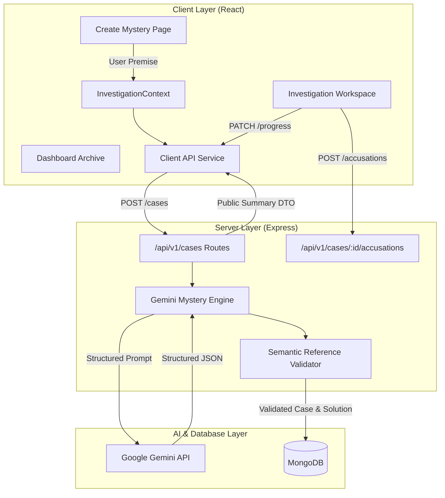

# Phase 4: Google Gemini Mystery Generation Engine & Client-Server Integration Plan

> **For agentic workers:** REQUIRED SUB-SKILL: Use superpowers:subagent-driven-development to implement this plan task-by-task. Steps use checkbox (`- [ ]`) syntax for tracking.

**Goal:** Implement the Google Gemini mystery generation engine (`@google/genai`) with structured JSON schemas and reference validation, connect Express case creation to the engine, wire the React client to live server REST endpoints with resilient offline fallbacks, and verify the complete investigation lifecycle.

**Architecture:** The server uses the `@google/genai` SDK with strict JSON response schemas to generate solvable, clue-corroborated mystery cases. A validation pipeline verifies reference integrity (culprit matches suspect, decisive clues exist, timeline links match) before database persistence. The React client's `InvestigationContext` connects via an API service layer to `/api/v1` with graceful degradation to local storage when backend is disconnected.

**Architecture Diagram:**

**Tech Stack:** `@google/genai`, Node.js, Express, Mongoose, Zod, React 19, Vite, Vitest.

**Spec References:**
- `Docs/AI_DEVELOPMENT_RULES.md` (Section 8: AI integration & mystery integrity)
- `Docs/DATA_MODEL.md` (Section 5: Case schema & subdocument validation)
- `Docs/API.md` (Section 3: Generation & Case lifecycle endpoints)
- `Docs/ACCEPTANCE_TESTS.md` (Section 6: E2E-001 & E2E-002)

---

## Global Constraints

- **Structured Output Integrity:** All Gemini generation calls must use structured JSON schemas.
- **Reference Integrity:** A case is only saved and playable if `culpritId` references an existing suspect, all `decisiveEvidenceIds` exist in `evidence`, and all `relatedSuspectIds`/`relatedEventIds` are valid.
- **Graceful Fallback:** If `GEMINI_API_KEY` is omitted or Gemini encounters transient network/quota limits, the service must safely generate a solver-guaranteed case from deterministic template seeds without crashing.
- **Zero Regressions:** All existing 48 tests across client and server must continue to pass 100%.

---

### Task 1: Gemini Mystery Generation Engine & Reference Validator

**Files:**
- Create: `server/src/services/geminiService.js`
- Create: `server/src/services/caseValidator.js`
- Modify: `server/src/config/env.js`
- Test: `server/tests/geminiService.test.js`

**Interfaces:**
- Consumes: `@google/genai`, `env.GEMINI_API_KEY`
- Produces: `generateMysteryCase({ scenario, category, difficulty, length })` returning validated case payload with canonical solution.

- [ ] **Step 1: Write test for Gemini service & validator (`server/tests/geminiService.test.js`)**

Verify:
- Validator accepts valid case payload with correct cross-references.
- Validator rejects payload if `culpritId` does not exist in `suspects`.
- Validator rejects payload if `decisiveEvidenceIds` contains non-existent clue ID.
- Service generates complete case with incident, suspects, evidence, timeline, and solution.
- Graceful fallback produces playable case when API key is missing or simulated error occurs.

- [ ] **Step 2: Implement `caseValidator.js`**

Validates:
- Structural bounds (minimum 2 suspects, minimum 3 evidence items, 1 incident).
- Reference integrity: `suspects.some(s => s.id === solution.culpritId)`.
- Clue integrity: `solution.decisiveEvidenceIds.every(id => evidence.some(e => e.id === id))`.

- [ ] **Step 3: Implement `geminiService.js`**

- Initializes `GoogleGenAI` client with `env.GEMINI_API_KEY`.
- Builds structured prompt with system instructions enforcing fair-play detective rules.
- Defines responseSchema with strict types.
- Catches errors and provides structured template fallback.

- [ ] **Step 4: Update `server/src/config/env.js` to include `GEMINI_API_KEY`**

- [ ] **Step 5: Run tests and commit**

Run: `npm test --workspace=server`
Commit: `feat(server): implement Google Gemini mystery generation engine and reference validator`

---

### Task 2: Connect Case Creation Endpoint to Generation Engine

**Files:**
- Modify: `server/src/routes/cases.js`
- Test: `server/tests/casesApi.test.js`

**Interfaces:**
- Consumes: `generateMysteryCase()` from `geminiService`
- Produces: `POST /api/v1/cases` generating and persisting custom AI cases.

- [ ] **Step 1: Write integration test in `server/tests/casesApi.test.js`**

Verify:
- `POST /api/v1/cases` calls generation engine, persists generated case, and returns public summary with `201`.
- Solution is saved in database but excluded from HTTP response.

- [ ] **Step 2: Update `server/src/routes/cases.js`**

- Call `generateMysteryCase()` in `POST /api/v1/cases`.
- Persist validated case in MongoDB.
- Initialize `InvestigationProgress` for the case.
- Return serialized public summary.

- [ ] **Step 3: Run tests and commit**

Run: `npm test --workspace=server`
Commit: `feat(server): connect case creation endpoint to Gemini mystery generation engine`

---

### Task 3: Client API Service Layer & Live Context Integration

**Files:**
- Create: `client/src/services/api.js`
- Modify: `client/src/context/InvestigationContext.jsx`
- Test: `client/tests/api.test.js`

**Interfaces:**
- Consumes: Express REST API at `http://localhost:5000/api/v1`
- Produces: Unified async methods in `InvestigationContext` (`createCase`, `selectCase`, `openEvidence`, `updateNotes`, `submitAccusation`).

- [ ] **Step 1: Write client API service test (`client/tests/api.test.js`)**

Verify:
- `getCases()`, `getCase(id)`, `createCase(opts)`, `updateProgress(id, data)`, `submitAccusation(id, data)`, `getResult(id)` invoke fetch with correct paths and envelopes.

- [ ] **Step 2: Implement `client/src/services/api.js`**

- Robust fetch client with configurable `API_BASE_URL` (default `http://localhost:5000/api/v1`).
- Handles response envelopes (`success: true, data: ...`) and error formatting.

- [ ] **Step 3: Update `InvestigationContext.jsx`**

- Synchronizes with server API when available.
- Gracefully falls back to local storage and sample case fixture when offline.
- Persists optimistic progress updates.

- [ ] **Step 4: Run tests and commit**

Run: `npm test --workspace=client`
Commit: `feat(client): implement API service layer and connect investigation context to live backend`

---

### Task 4: Full Monorepo Acceptance & End-to-End Verification

- [ ] **Step 1: Run complete monorepo test suite**
Run: `npm test`
Expected: 100% pass across all server and client test suites.

- [ ] **Step 2: Build client production bundle**
Run: `npm run build --workspace=client`
Expected: Successful build with zero errors.

- [ ] **Step 3: Commit Phase 4 completion**
Commit: `chore: complete Phase 4 Gemini generation engine and full-stack integration`
