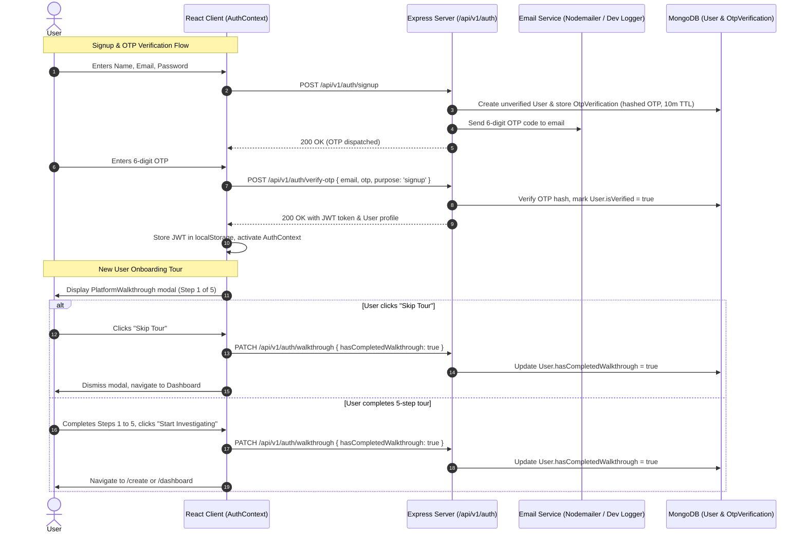

# Design Spec: Email OTP Authentication & Interactive Platform Walkthrough

## 1. Problem Statement & User Goals
The application currently treats all users as `user_anonymous`, preventing users from maintaining their personal investigation archives across devices, saving detective statistics securely, or receiving guided onboarding into the multi-faceted features of the mystery room (case creation, evidence cataloging, timeline reconstruction, and server-authoritative accusation).

### User Goals:
1. **User Authentication**: Register, log in, and reset forgotten passwords securely using verified email credentials.
2. **Email OTP Verification**: Ensure email authenticity via 6-digit numeric OTP codes during registration, login verification, and password reset.
3. **Interactive Onboarding Walkthrough**: Introduce new users to the platform's core capabilities via an interactive, step-by-step guided tour with a persistent "Skip" option.

---

## 2. Architecture & Data Flow



---

## 3. Data Models

### 3.1 User Model (`server/src/models/User.js`)
```javascript
{
  name: { type: String, required: true, trim: true },
  email: { type: String, required: true, unique: true, lowercase: true, trim: true, index: true },
  passwordHash: { type: String, required: true },
  isVerified: { type: Boolean, default: false, index: true },
  hasCompletedWalkthrough: { type: Boolean, default: false },
  createdAt: { type: Date, default: Date.now },
  updatedAt: { type: Date, default: Date.now }
}
```

### 3.2 OtpVerification Model (`server/src/models/OtpVerification.js`)
```javascript
{
  email: { type: String, required: true, lowercase: true, index: true },
  otpHash: { type: String, required: true },
  purpose: { type: String, enum: ['signup', 'login', 'reset_password'], required: true },
  expiresAt: { type: Date, required: true, index: { expires: '10m' } },
  attempts: { type: Number, default: 0 }
}
```

---

## 4. REST API Specification

### 4.1 `POST /api/v1/auth/signup`
- **Request Body**:
  ```json
  {
    "name": "Detective Vance",
    "email": "vance@agency.com",
    "password": "SecretPassword123"
  }
  ```
- **Validation**:
  - `name`: min 2 chars.
  - `email`: valid email regex.
  - `password`: min 8 chars with at least one letter and one number.
- **Behavior**:
  - Rejects if verified user already exists with this email (`409 Conflict`).
  - Upserts unverified user record with hashed password (`bcryptjs.hash(password, 10)`).
  - Generates 6-digit cryptographically random OTP (`crypto.randomInt(100000, 999999)`).
  - Hashes OTP and saves to `OtpVerification` with 10-minute expiry.
  - Sends email via `emailService.js`.
- **Response**: `200 OK` `{ success: true, message: "Verification OTP dispatched to email", data: { email: "vance@agency.com" } }`

### 4.2 `POST /api/v1/auth/verify-otp`
- **Request Body**:
  ```json
  {
    "email": "vance@agency.com",
    "otp": "492817",
    "purpose": "signup"
  }
  ```
- **Behavior**:
  - Finds active `OtpVerification` for `email` and `purpose`.
  - Increments `attempts`. If `attempts > 5`, deletes record and returns `429 Too Many Requests`.
  - Verifies OTP against `otpHash` using `bcrypt.compare`.
  - If valid:
    - If `purpose === 'signup'`, updates `User.isVerified = true`.
    - Generates signed JWT (`jwt.sign({ userId, email }, env.JWT_SECRET, { expiresIn: '7d' })`).
    - Deletes OTP record.
- **Response**: `200 OK` `{ success: true, data: { token: "...", user: { id, name, email, hasCompletedWalkthrough: false } } }`

### 4.3 `POST /api/v1/auth/login`
- **Request Body**:
  ```json
  {
    "email": "vance@agency.com",
    "password": "SecretPassword123"
  }
  ```
- **Behavior**:
  - Finds user by email. Rejects if not found or password incorrect with generic `401 Unauthorized` message.
  - Rejects if `isVerified === false` with code `ACCOUNT_NOT_VERIFIED` (automatically triggers new signup OTP dispatch).
  - Returns JWT + user profile.

### 4.4 `POST /api/v1/auth/forgot-password`
- **Request Body**: `{ "email": "vance@agency.com" }`
- **Behavior**:
  - Finds user. If user doesn't exist, still returns generic `200 OK` for privacy.
  - If user exists, generates OTP for `purpose: 'reset_password'`, saves to DB, sends email.

### 4.5 `POST /api/v1/auth/reset-password`
- **Request Body**:
  ```json
  {
    "email": "vance@agency.com",
    "otp": "492817",
    "newPassword": "BrandNewPassword123"
  }
  ```
- **Behavior**:
  - Verifies OTP for `reset_password`.
  - Hashes `newPassword` and updates user record.
  - Returns `200 OK` with fresh JWT and user profile.

### 4.6 `GET /api/v1/auth/me`
- **Headers**: `Authorization: Bearer <token>`
- **Behavior**: Returns current authenticated user profile.

### 4.7 `PATCH /api/v1/auth/walkthrough`
- **Headers**: `Authorization: Bearer <token>`
- **Request Body**: `{ "hasCompletedWalkthrough": true }`
- **Behavior**: Sets `hasCompletedWalkthrough: true` on user document.

---

## 5. Email Service Architecture (`server/src/services/emailService.js`)
- Configured via environment variables:
  - `SMTP_HOST`: default `''`
  - `SMTP_PORT`: default `587`
  - `SMTP_USER`: default `''`
  - `SMTP_PASS`: default `''`
  - `EMAIL_FROM`: default `"AI Mystery Room <no-reply@mysteryroom.io>"`
- **Development & Fallback Mode**:
  - If `SMTP_HOST` or `SMTP_USER` is empty, or if `NODE_ENV === 'test'` or `'development'`:
    - Formats a terminal Neo-Brutalist log box containing the email recipient, purpose, and 6-digit OTP code.
    - Resolves successfully so automated tests and local development never stall.
- **Production Mode**:
  - Sends HTML + Plain text email with neo-brutalist styling:
    - Subject: `Your AI Mystery Room Access Code: [OTP]`
    - Body: Includes 6-digit code in bold monospaced container with expiration notice (10 minutes).

---

## 6. Frontend Authentication & Walkthrough Implementation

### 6.1 `AuthContext.jsx`
- Manages `user`, `token`, `isAuthenticated`, `isLoading`, and `isWalkthroughOpen`.
- Attaches JWT token to all API requests made via `client/src/services/api.js`.
- Automatically opens `PlatformWalkthrough` modal when a newly verified user logs in and `user.hasCompletedWalkthrough === false`.

### 6.2 `AuthModal.jsx`
- Multi-state neo-brutalist modal:
  1. `LOGIN`: Email + Password with links to "Create Account" and "Forgot Password".
  2. `SIGNUP`: Name + Email + Password -> transitions to OTP verification.
  3. `OTP_VERIFY`: 6 digit input, countdown timer (60s), Resend OTP button.
  4. `FORGOT_PASSWORD`: Email entry -> transitions to `RESET_PASSWORD` (OTP + New Password).

### 6.3 `PlatformWalkthrough.jsx`
- Floating Neo-Brutalist guided tour card with backdrop overlay:
  - **Slide 1: Command Center (Dashboard)**: Learn how your active dossiers, case status, and solve records are tracked.
  - **Slide 2: Mystery Synthesis (Create Case)**: Learn how to configure custom scenarios, categories (Theft, Murder, Cybercrime, Espionage), and difficulty tiers.
  - **Slide 3: Forensic Workspace**: Learn about the 5 core investigation tabs: Incident Brief, Suspect Rosters, Evidence Catalog, Timeline, and Detective Notes.
  - **Slide 4: Multi-Format Evidence Viewers**: Explore how to inspect encrypted chat transcripts, CCTV video freezes, and badge access logs.
  - **Slide 5: The Final Indictment & Accusation**: Learn how the server-authoritative verdict scoring works and how canonical solutions are revealed post-indictment.
- **Controls**:
  - Step Indicator: `[ STEP 1 OF 5 ]`
  - Top-Right & Bottom-Right **"SKIP TOUR"** button: Immediately dismisses tour and calls `completeWalkthrough()`.
  - "Previous" and "Next" buttons.
  - Final button: "FINISH & START INVESTIGATING".
- **Navbar Access**:
  - Top navigation bar includes a **"GUIDED TOUR"** button with a Compass icon to reopen the walkthrough at any time.

---

## 7. Testing & Acceptance Criteria
1. **Server Unit & API Tests (`server/tests/authApi.test.js`)**:
   - `POST /api/v1/auth/signup` generates OTP and unverified user.
   - `POST /api/v1/auth/verify-otp` validates code and issues JWT token.
   - `POST /api/v1/auth/verify-otp` rejects wrong OTP and limits attempts.
   - `POST /api/v1/auth/login` verifies password and returns user profile.
   - `POST /api/v1/auth/forgot-password` and `POST /api/v1/auth/reset-password` reset credentials.
   - `PATCH /api/v1/auth/walkthrough` sets `hasCompletedWalkthrough: true`.
2. **Client Unit & Integration Tests (`client/tests/AuthAndWalkthrough.test.jsx`)**:
   - `AuthModal` renders Login, Signup, and OTP input fields.
   - Successful signup triggers OTP view and handles submission.
   - `PlatformWalkthrough` renders 5 tour steps with Next/Back navigation.
   - Clicking "Skip Tour" immediately calls `completeWalkthrough` and closes modal.
   - "Platform Tour" button in Navbar launches walkthrough on demand.
3. **Monorepo Zero-Regression Assurance**:
   - All existing 59 tests continue to pass 100%.
   - Client bundle builds with zero errors.
