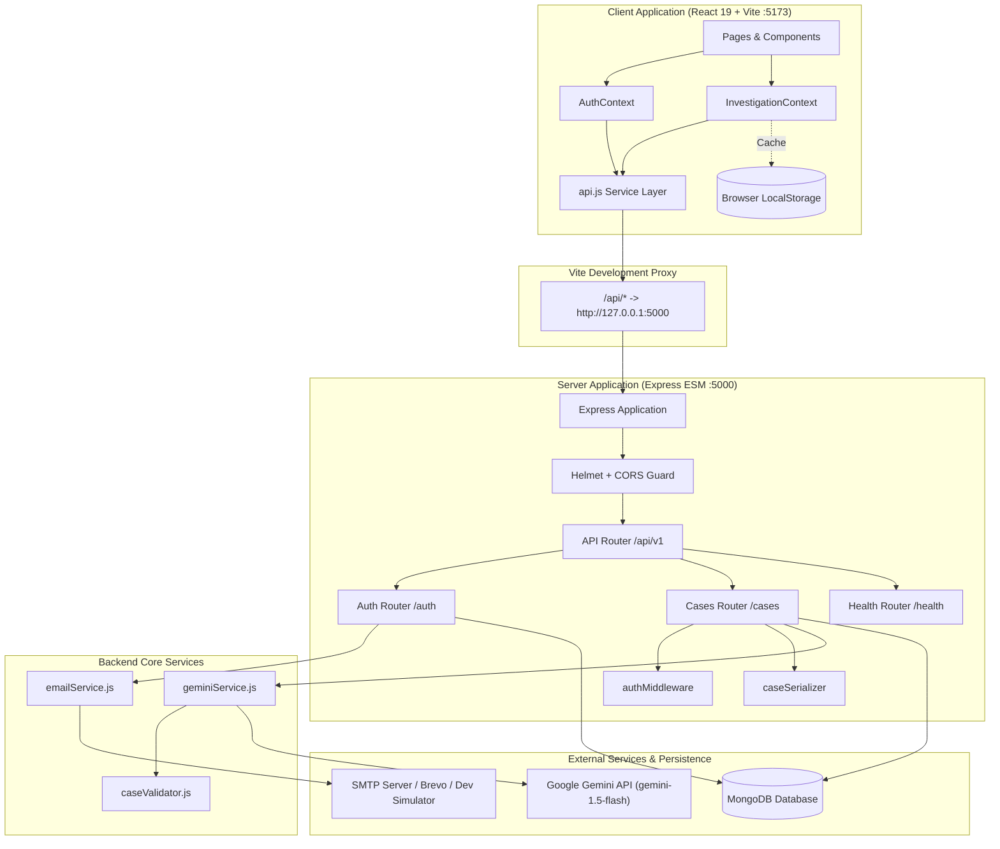

# AI Mystery Room

An interactive, AI-assisted detective mystery investigation platform built with a high-contrast Neo-Brutalist design system. Players step into the role of a lead investigator: generating original crime cases, inspecting digital evidence across specialized viewers, interrogating suspect statements, tracking timelines, recording theories, and submitting server-authoritative accusations against a hidden canonical solution.

Unlike conventional storytelling chatbots, **AI Mystery Room** enforces strict detective-fiction rules: the ground truth, culprit, motive, and decisive refutation evidence are established and locked before gameplay begins. The canonical solution is strictly sealed on the backend, ensuring players must actively deduce the culprit from clues, alibis, and documented contradictions rather than prompting an LLM for answers.

---

## Table of Contents

- [Project Overview](#project-overview)
  - [The Detective Experience](#the-detective-experience)
  - [AI Generation vs. Deterministic Game Rules](#ai-generation-vs-deterministic-game-rules)
  - [Canonical Solution Protection](#canonical-solution-protection)
- [Feature Matrix](#feature-matrix)
- [Screenshots and Demo](#screenshots-and-demo)
- [Technology Stack](#technology-stack)
- [Architecture Overview](#architecture-overview)
  - [Logical System Architecture](#logical-system-architecture)
  - [Subsystem Responsibilities](#subsystem-responsibilities)
  - [Security Boundaries](#security-boundaries)
- [Repository Structure](#repository-structure)
- [Prerequisites](#prerequisites)
- [Installation and Local Development](#installation-and-local-development)
- [Environment Variables](#environment-variables)
- [Application Usage & Investigation Workflow](#application-usage--investigation-workflow)
- [API Overview](#api-overview)
  - [Health & Diagnostics](#health--diagnostics)
  - [Authentication & Account Recovery](#authentication--account-recovery)
  - [Case Management & Investigation](#case-management--investigation)
  - [Accusation & Authorized Reveal](#accusation--authorized-reveal)
- [Testing and Quality Assurance](#testing-and-quality-assurance)
  - [Test Suite Summary](#test-suite-summary)
  - [Running Tests & Build Checks](#running-tests--build-checks)
- [Security and Privacy Controls](#security-and-privacy-controls)
- [AI Integration and Reliability Engine](#ai-integration-and-reliability-engine)
- [Production Build and Deployment Guide](#production-build-and-deployment-guide)
- [Troubleshooting](#troubleshooting)
- [Development Workflow and Engineering Rules](#development-workflow-and-engineering-rules)
- [Roadmap and Limitations](#roadmap-and-limitations)
- [Documentation Index](#documentation-index)
- [License and Acknowledgments](#license-and-acknowledgments)

---

## Project Overview

### The Detective Experience

In **AI Mystery Room**, players take on active investigative work rather than passive reading. Every case presents:
1. **An Incident Dossier:** An executive summary detailing the crime scene, time of occurrence, location, and immediate perimeter observations.
2. **A Suspect Roster:** Detailed profiles of suspects with declared backgrounds, occupations, motives, relationships, public statements, and stated alibis.
3. **Multi-Format Evidence Library:** Digital evidence items categorized into specific forensic formats (chat transcripts, leaked documents, surveillance camera stills/logs, and physical crime scene photos).
4. **Chronological Timeline:** Time-stamped sequences of verifiable events cross-linked to specific suspects and evidence.
5. **Detective Notepad:** Persistent notebook allowing investigators to write down hypotheses, cross-examine clue IDs, and track conflicting testimonies.
6. **Indictment Accusation Chamber:** A formal submission interface where the player names the perpetrator and presents their reasoning.
7. **Canonical Solution Reveal:** A comprehensive debrief unlocked only after an indictment is lodged, breaking down why the culprit is guilty, citing decisive disproving evidence, and exposing red herrings.

### AI Generation vs. Deterministic Game Rules

A foundational principle of AI Mystery Room is that **generative models participate only as case architects, never as live arbiters of game rules or factual truth**:

| Domain | Handled By | Mechanism |
|---|---|---|
| **Mystery Creation** | Google Gemini (`@google/genai`) | Generates structured JSON adhering to a strict Type schema with 3–4 suspects, 4–6 evidence items, timeline events, and a hidden solution object. |
| **Referential Integrity** | Backend Validator (`caseValidator.js`) | Rejects cases where the culprit is not in the suspect roster, decisive evidence IDs do not exist, or entities have duplicate identifiers. |
| **Fail-Safe Generation** | Deterministic Engine (`geminiService.js`) | If the AI provider is unavailable, rate-limited, or outputs invalid references, the system falls back seamlessly to a handcrafted, guaranteed-solvable mystery template. |
| **Scoring & Guilt Determination** | Deterministic Backend (`cases.js`) | Evaluation compares `selectedSuspectId === caseDoc.solution.culpritId` directly in Node.js. The AI model is never prompted to judge the user's guilt verdict. |
| **Case Lifecycle** | Database State Machine | Mongoose models enforce transition rules (`generating` $\rightarrow$ `active` $\rightarrow$ `completed`). |

### Canonical Solution Protection

In conventional mystery software, client bundles often leak the culprit ID or hidden solution through frontend state or unscrubbed REST payloads. AI Mystery Room implements a strict server-side serialization boundary:
- **Public Serializers (`caseSerializer.js`):** The `serializePublicCase` and `serializePublicCaseSummary` transforms explicitly strip `solution`, `truthGraph`, and hidden internal keys before any JSON response leaves the server.
- **Access Control:** The route `GET /api/v1/cases/:caseId/result` checks `caseDoc.status === 'completed'`. Attempting to query the solution while a case is `active` returns HTTP `409 Conflict` (`CASE_NOT_COMPLETED`).

---

## Feature Matrix

The following table reflects the actual state of the repository, validated against implementation files and automated test suites:

| Feature | Description | Status |
|---|---|---|
| **User Registration & Login** | Detective ID (Username) + password authentication with bcrypt hashing (10 salt rounds) and 7-day signed JWT tokens. | `Implemented` |
| **Interactive Walkthrough** | 4-step detective onboarding modal for first-time detectives, persisted across sessions via `hasCompletedWalkthrough` on the user record. | `Implemented` |
| **AI Mystery Case Generation** | On-demand creation of original mysteries using Google Gemini (`gemini-1.5-flash`) via `@google/genai` structured JSON outputs. | `Implemented` |
| **Deterministic Fallback Engine** | Offline, solver-guaranteed template generation fallback triggered if the Gemini API key is missing, network fails, or validation errors occur. | `Implemented` |
| **Referential Integrity Validator** | Rigorous verification validating that culprit IDs, decisive evidence IDs, and red herring references exist across suspect and evidence collections. | `Implemented` |
| **Investigation Workspace** | Tabbed detective workspace with Case Overview, Suspect Roster, Evidence Catalog, Timeline, and Detective Notepad. | `Implemented` |
| **Type-Specific Evidence Viewers** | Custom viewer components tailored for Chat Messages, Document Transcripts, Surveillance CCTV logs, and Forensic Crime Photos. | `Implemented` |
| **Detective Notepad Persistence** | In-context notes editor automatically synchronized with the server (`PATCH /cases/:id/progress`) and cached in browser storage. | `Implemented` |
| **Server-Authoritative Accusation** | Indictment submission endpoint that deterministically evaluates guilt against the sealed solution and locks the case lifecycle. | `Implemented` |
| **Authorized Solution Debrief** | Post-verdict reveal screen presenting the true culprit, motive, execution method, decisive evidence refutations, and explained red herrings. | `Implemented` |
| **Personal Case Dashboard** | Overview page listing active and completed cases with progress badges, time logs, and deletion capabilities. | `Implemented` |
| **Neo-Brutalist Design System** | High-contrast UI with hard offset drop-shadows, cream paper background (`#FFF9EE`), bold typography (Space Grotesk & Inter), and rich accents. | `Implemented` |
| **Interactive Evidence Board** | Canvas workspace with pins, drag-and-drop evidence cards, yarn connection threads, and contradiction markers. | `Planned` (Specified in `Docs/specs.md` & `Docs/DESIGN_SPEC.md`) |
| **Dynamic Case Visual Themes** | Setting-specific visual themes (e.g., Noir, Cyberpunk, Victorian) dynamically adapting palette tokens per case category. | `Planned` (Design tokens defined; full theme switcher pending) |
| **Daily Mystery Challenges** | Globally synchronized daily cases with shared leaderboards, detective ranks, and reasoning scores. | `Planned` |

---

## Screenshots and Demo

> [!NOTE]
> Static screenshot assets and live demonstration recordings are not currently stored in the git repository tree to keep repository size lean.

Contributors wishing to document UI walkthroughs should capture high-resolution screenshots (PNG format, 1280x800 minimum) and place them under a `docs/assets/screenshots/` directory, linking them into pull requests:
- `01_landing_hero.png`: Neo-Brutalist landing page and case registry.
- `02_create_mystery.png`: AI case generation prompt and configuration interface.
- `03_investigation_workspace.png`: Case dossier, suspect profiles, and timeline.
- `04_evidence_viewer.png`: Type-specific digital evidence inspect modal.
- `05_accusation_reveal.png`: Canonical solution debrief and scoring verdict.

---

## Technology Stack

The stack has been verified directly against `package.json`, `server/package.json`, and `client/package.json`:

```
                           AI Mystery Room Stack
  ┌─────────────────────────────────────────────────────────────────────────┐
  │                                CLIENT                                   │
  │  React 19.0.0  •  React Router 7.18.4  •  Vite 6.0.11  •  Tailwind 3.4  │
  │  Lucide React  •  Space Grotesk / Inter  •  Vitest 3.0 + Testing Library│
  └────────────────────────────────────┬────────────────────────────────────┘
                                       │ HTTP / REST (/api/v1)
                                       │ (Vite Proxy in Dev)
  ┌────────────────────────────────────┴────────────────────────────────────┐
  │                                SERVER                                   │
  │  Node.js (ESM)  •  Express 4.21.2  •  Mongoose 8.9.5  •  Zod 3.24.1     │
  │  JWT (jsonwebtoken 9.0) •  BcryptJS 3.0 • Helmet 8.0                    │
  └──────────────────┬───────────────────────────────────┬──────────────────┘
                     │ Mongoose ODM                      │ Google GenAI SDK
  ┌──────────────────┴───────────────┐   ┌───────────────┴──────────────────┐
  │             DATABASE             │   │            AI ENGINE             │
  │     MongoDB (Local / Atlas)      │   │   Google Gemini (gemini-1.5-flash)│
  │ (mongodb-memory-server in tests) │   │   Structured Output JSON Schema  │
  └──────────────────────────────────┘   └──────────────────────────────────┘
```

### Frontend (`client/`)
- **Core Framework:** [React 19.0.0](https://react.dev/) with functional components and hooks.
- **Routing:** [React Router v7.18.4](https://reactrouter.com/) configuring protected routes, investigation child views, and navigation guards.
- **Build & Development Tooling:** [Vite 6.0.11](https://vitejs.dev/) with `@vitejs/plugin-react` and built-in reverse proxy configuration.
- **Styling & Design System:** [Tailwind CSS 3.4.17](https://tailwindcss.com/), `@tailwindcss/postcss`, `clsx`, `tailwind-merge`, and custom CSS custom properties (`tokens.css`).
- **Icons & Typography:** [Lucide React 0.474.0](https://lucide.dev/), `@fontsource/space-grotesk`, `@fontsource/inter`.
- **Testing:** [Vitest 3.0.4](https://vitest.dev/), `@testing-library/react 16.2.0`, `@testing-library/jest-dom 6.6.3`, and `jsdom 26.0.0`.

### Backend (`server/`)
- **Runtime:** [Node.js](https://nodejs.org/) (ES Modules, `"type": "module"`).
- **Web Framework:** [Express 4.21.2](https://expressjs.com/) with modular routing, centralized error handling, and JSON body parsing.
- **Database & ODM:** [MongoDB](https://www.mongodb.com/) via [Mongoose 8.9.5](https://mongoosejs.com/) featuring schema validations, embedded subdocuments, and TTL indexes.
- **AI Integration:** Google GenAI SDK [`@google/genai` 2.31.0](https://www.npmjs.com/package/@google/genai) with strict structured JSON schema generation.
- **Schema Validation:** [Zod 3.24.1](https://zod.dev/) validating incoming request bodies and environment configurations.
- **Security & Cryptography:** [bcryptjs 3.0.3](https://www.npmjs.com/package/bcryptjs) for password hashing; [jsonwebtoken 9.0.3](https://www.npmjs.com/package/jsonwebtoken) for stateless Bearer tokens; [helmet 8.0.0](https://helmetjs.github.io/) for HTTP security headers; [cors 2.8.5](https://www.npmjs.com/package/cors) for origin control.
- **Testing:** [Vitest 3.0.4](https://vitest.dev/), [supertest 7.0.0](https://www.npmjs.com/package/supertest), and [mongodb-memory-server 10.1.3](https://www.npmjs.com/package/mongodb-memory-server).

---

## Architecture Overview

### Logical System Architecture

The following diagram illustrates the active, implemented component architecture and request flow:



### Subsystem Responsibilities

1. **Client Application (`client/`):**
   - Renders interactive investigation views and handles optimistic local state updates.
   - Manages user sessions via `AuthContext`, storing tokens in `localStorage` under `ai_mystery_token`.
   - Caches active case progress, opened evidence lists, and notes via `InvestigationContext`.
   - Intercepts API failures, transforming backend error structures (`{ code, message, fields }`) into visible notifications.

2. **Backend REST API (`server/`):**
   - Serves as the single authority for authentication, case generation, notes persistence, and verdict scoring.
   - Sanitizes and serializes public case documents, removing private answers before sending JSON to the browser.
   - Evaluates accusations deterministically without relying on third-party AI at runtime.

3. **Data Persistence (`server/src/models/`):**
   - **`User`**: Account credentials, unique Detective ID / Username, and walkthrough flags.
   - **`Case`**: Full case dossiers including embedded suspects, timeline events, evidence items, and sealed `solution` schemas.
   - **`InvestigationProgress`**: Tracks opened evidence IDs, user notes, and lifecycle timestamps for each user-case pair.
   - **`Accusation`**: Records final indictments, selected suspect IDs, reasoning, timestamps, and calculated score.

4. **AI Generation Subsystem (`server/src/services/`):**
   - Prompts Google Gemini with structured output requirements.
   - Parses the JSON output and runs structural and referential verification via `caseValidator.js`.
   - Intercepts provider outages, invalid API keys, and reference mismatches by substituting guaranteed-solvable fallback cases.

### Security Boundaries

The application enforces four strict architectural security boundaries:
1. **Network & Proxy Boundary:** In development, client requests go through Vite's reverse proxy (`/api`) to avoid exposing internal network topologies. In production, CORS strictly whitelists verified client origins.
2. **Canonical State Isolation:** The database stores the true solution under `Case.solution`, but public serializers filter out solution data before any case payload is returned to the client.
3. **Verdict Evaluation Authority:** Guilt evaluation is strictly deterministic on the backend (`casesRouter.post('/:caseId/accusations')`), comparing IDs in Node.js rather than relying on generative model prompts.
4. **Credential & Secret Protection:** Third-party AI tokens and SMTP passwords remain confined to server-side memory and are never prefixed with `VITE_` or sent over client channels.

---

## Repository Structure

```
AI Mystery Room/
├── package.json                   # Root package manifest configuring npm workspaces ('server', 'client')
├── package-lock.json              # Monorepo lockfile
├── .env.example                   # Baseline environment variable documentation template
├── .gitignore                     # Git ignore rules for node_modules, build outputs, and credentials
├── Docs/                          # Architecture, specification, and engineering contracts
│   ├── ACCEPTANCE_TESTS.md        # Observable acceptance testing checklists and test scenarios
│   ├── AI_DEVELOPMENT_RULES.md    # Mandatory coding and architecture standards for AI contributors
│   ├── API.md                     # Authoritative REST API contract and endpoint specifications
│   ├── DATA_MODEL.md              # MongoDB collections, Mongoose schemas, and lifecycle rules
│   ├── DESIGN_SPEC.md             # Neo-Brutalist UI/UX design specifications, tokens, and layouts
│   ├── FEATURE_DELIVERY_WORKFLOW.md # "One feature at a time" implementation & test-gate process
│   ├── specs.md                   # Single Source of Truth (SSOT) product specification
│   ├── SYSTEM_DESIGN.md           # Production scalability, reliability, and deployment design
│   ├── USER_FLOWS.md              # Step-by-step user interaction maps and navigation contracts
│   └── superpowers/               # Execution plans and design specifications for feature phases
│       ├── plans/
│       └── specs/
├── client/                        # Frontend Single-Page Application
│   ├── package.json               # Frontend dependencies and scripts (Vite, React 19, Tailwind)
│   ├── vite.config.js             # Vite configuration with /api reverse proxy and Vitest setup
│   ├── tailwind.config.js         # Neo-Brutalist color extensions, hard shadows, and typography
│   ├── postcss.config.js          # PostCSS configuration for Tailwind CSS and Autoprefixer
│   ├── index.html                 # HTML entry point with Space Grotesk & Inter font imports
│   ├── src/
│   │   ├── main.jsx               # React DOM mounting entry point
│   │   ├── App.jsx                # Route definitions, layout wrappers, and global modals
│   │   ├── components/            # Reusable UI component library
│   │   │   ├── accusation/        # Accusation confirmation dialogs and forms
│   │   │   ├── auth/              # AuthModal, ProtectedRoute guards, and form controls
│   │   │   ├── dashboard/         # CaseCard summary cards and case deletion modals
│   │   │   ├── evidence/          # Specialized viewers (Chat, Document, Image, Surveillance)
│   │   │   ├── landing/           # Hero section, feature grids, and sample case showcases
│   │   │   ├── layout/            # Top Navbar and Footer components
│   │   │   ├── ui/                # Base Neo-Brutalist Button, Card, and container primitives
│   │   │   └── walkthrough/       # Detective onboarding tutorial modal
│   │   ├── context/               # Global React state providers
│   │   │   ├── AuthContext.jsx    # Session management, token storage, and auth actions
│   │   │   └── InvestigationContext.jsx # Active case state, evidence tracking, notes sync
│   │   ├── data/
│   │   │   └── sampleCase.js      # Seed case fixture ("The Obsidian Crown Heist")
│   │   ├── layouts/
│   │   │   └── InvestigationLayout.jsx # Top bar and navigation tabs for investigation workspace
│   │   ├── pages/                 # Route-level page components
│   │   │   ├── LandingPage.jsx    # Public showcase and portal landing page
│   │   │   ├── LoginPage.jsx      # Dedicated email/password login screen
│   │   │   ├── SignupPage.jsx     # Registration screen with in-page 6-digit OTP entry
│   │   │   ├── ForgotPasswordPage.jsx # Password recovery screen with OTP reset
│   │   │   ├── DashboardPage.jsx  # Personal investigation registry and case stats
│   │   │   ├── CreateMysteryPage.jsx # Case generation premise input and difficulty selectors
│   │   │   ├── AccusationPage.jsx # Suspect indictment and reasoning submission page
│   │   │   ├── ResultRevealPage.jsx # Sealed solution reveal and scoring debrief screen
│   │   │   ├── evidence/          # Dedicated route for focused evidence inspection
│   │   │   │   └── EvidenceViewerPage.jsx
│   │   │   └── investigation/     # Modular views inside the investigation workspace
│   │   │       ├── CaseOverviewView.jsx
│   │   │       ├── SuspectsView.jsx
│   │   │       ├── EvidenceView.jsx
│   │   │       ├── TimelineView.jsx
│   │   │       ├── NotesView.jsx
│   │   │       └── SuspectProfileModal.jsx
│   │   ├── services/
│   │   │   └── api.js             # Client HTTP client with token injection and error parsing
│   │   └── styles/
│   │       ├── index.css          # Global Tailwind directives
│   │       └── tokens.css         # Neo-Brutalist CSS variables and box-shadow definitions
│   └── tests/                     # Client Vitest + React Testing Library suites (13 files, 58 tests)
└── server/                        # Backend REST API Service
    ├── package.json               # Backend dependencies (Express, Mongoose, @google/genai, Zod)
    ├── vitest.config.js           # Vitest server test runner configuration
    ├── src/
    │   ├── server.js              # Server entry point; establishes MongoDB connection and listens
    │   ├── app.js                 # Express application configuration, middleware, and route mounts
    │   ├── config/
    │   │   ├── db.js              # Mongoose database connection lifecycle handlers
    │   │   └── env.js             # Zod environment variable parsing and validation
    │   ├── middleware/
    │   │   ├── authMiddleware.js  # JWT validation (`requireAuth`, `optionalAuth`)
    │   │   └── errorHandler.js    # 404 handler and central JSON error serializer
    │   ├── models/                # Mongoose data models
    │   │   ├── User.js            # User credentials, username ID, and walkthrough state
    │   │   ├── Case.js            # Mystery cases with embedded suspects, evidence, and solution
    │   │   ├── InvestigationProgress.js # Per-user case activity and notes tracking
    │   │   └── Accusation.js      # Submitted indictments, reasoning, and evaluated scores
    │   ├── routes/                # Express REST route handlers
    │   │   ├── index.js           # Router aggregator mounting `/cases`, `/auth`, and `/health`
    │   │   ├── health.js          # Health check endpoint returning status and uptime
    │   │   ├── auth.js            # Direct signup, login, profile, and walkthrough endpoints
    │   │   └── cases.js           # Case CRUD, progress tracking, accusations, and solution reveal
    │   ├── serializers/
    │   │   └── caseSerializer.js  # Public DTO sanitizers stripping canonical solution fields
    │   ├── services/
    │   │   ├── geminiService.js   # Google GenAI integration with deterministic template fallback
    │   │   └── caseValidator.js   # Referential integrity validator for generated mysteries
    │   └── utils/
    │       ├── response.js        # Standardized API response helpers (`sendSuccess`, `sendError`)
    │       └── token.js           # JWT signature and token verification utilities
    └── tests/                     # Server Vitest + Supertest suites (7 files, 39 tests)
```

---

## Prerequisites

Before starting local development, ensure your environment meets the following requirements:

| Prerequisite | Required Version | Verification Command | Purpose |
|---|---|---|---|
| **Node.js** | `>= 18.0.0` (Tested on `v22.20.0`) | `node -v` | JavaScript runtime executing backend and build scripts. |
| **npm** | `>= 9.0.0` (Tested on `11.3.0`) | `npm -v` | Package manager supporting npm workspaces. |
| **MongoDB** | `>= 6.0` (Local daemon or Mongo Atlas) | `mongod --version` or mongosh | Primary document database storing cases and user accounts. |
| **Google Gemini API Key** | Optional for dev / Required for AI generation | — | Enables AI-assisted mystery case creation via `@google/genai`. |
| **SMTP Mail Server** | Optional for dev / Required for production mail | — | Transports real verification codes; terminal simulator used if omitted. |

---

## Installation and Local Development

Follow this step-by-step guide to clone, configure, and launch the application locally:

### 1. Clone the Repository

```bash
git clone https://github.com/abhaysoni007/AI-Mystery-Room.git
cd "AI Mystery Room"
```

### 2. Install Dependencies

The repository utilizes **npm workspaces**. Running `npm install` at the project root automatically installs dependencies across the root, server, and client workspaces:

```bash
npm install
```

### 3. Configure Environment Variables

Create a local `.env` file at the repository root by copying `.env.example`:

```bash
cp .env.example .env
```

Open `.env` in your editor. At minimum, ensure `MONGODB_URI` points to a reachable MongoDB database (e.g., local MongoDB on `mongodb://localhost:27017/ai-mystery-room`).

```ini
PORT=5000
NODE_ENV=development
MONGODB_URI=mongodb://localhost:27017/ai-mystery-room
CLIENT_URL=http://localhost:5173
JWT_SECRET=development_super_secret_jwt_key_32_characters_minimum
GEMINI_API_KEY=your_gemini_api_key_here
GEMINI_MODEL=gemini-1.5-flash
```

> [!TIP]
> If you do not have a Gemini API key or internet access, leave `GEMINI_API_KEY` blank. The backend will automatically activate the **Deterministic Fallback Engine** (`generateFallbackCase`), allowing you to create and investigate fully solvable cases offline.

### 4. Verify MongoDB is Running

Ensure your local MongoDB daemon is running:

```bash
# macOS (Homebrew)
brew services start mongodb/brew/mongodb-community

# Linux (systemd)
sudo systemctl start mongod

# Windows (PowerShell service check)
Get-Service -Name MongoDB
```

### 5. Start the Development Servers

Open two separate terminal windows or tabs to run the backend and frontend concurrently:

#### Terminal 1 — Start the Backend Server:
```bash
npm run dev:server
```
*The server will start on [http://localhost:5000](http://localhost:5000) with automatic reload (`node --watch src/server.js`).*

#### Terminal 2 — Start the Frontend Client:
```bash
npm run dev:client
```
*Vite will compile and serve the frontend on [http://localhost:5173](http://localhost:5173).*

### 6. Verify Local Operation

1. Open your browser and navigate to **`http://localhost:5173`**.
2. Click **"New Case"** or navigate to `/create`.
3. Register a new investigator account.
4. Check the **backend terminal window** for your 6-digit OTP code (or observe the on-screen development helper card), enter the code, and begin investigating!

---

## Environment Variables

All backend environment variables are parsed and validated at startup using Zod in [`server/src/config/env.js`](server/src/config/env.js). Frontend variables are accessed via Vite's `import.meta.env`.

| Variable | Component | Required | Purpose | Safe Example / Default |
|---|---|---|---|---|
| `PORT` | Server | Optional | Port for the Express HTTP server. | `5000` |
| `NODE_ENV` | Server | Optional | Application runtime mode (`development`, `test`, `production`). | `development` |
| `MONGODB_URI` | Server | **Required** | MongoDB connection string including credentials and database name. | `mongodb://localhost:27017/ai-mystery-room` |
| `CLIENT_URL` | Server | Optional | Allowed origin for Cross-Origin Resource Sharing (CORS). | `http://localhost:5173` |
| `FRONTEND_URL` | Server | Optional | Alternative alias for the client domain. | `http://localhost:5173` |
| `JWT_SECRET` | Server | **Required in Prod** | Secret key used to sign and verify JSON Web Tokens. | `super_secret_jwt_key_change_in_production` |
| `GEMINI_API_KEY` | Server | Optional | Google Gemini API key used for structured case generation. If unset, fallback engine runs. | `AIzaSyD-placeholder-key` |
| `GEMINI_MODEL` | Server | Optional | Model identifier passed to `@google/genai`. | `gemini-1.5-flash` |
| `VITE_API_URL` | Client | Optional | Base URL for API requests. Defaults to `/api/v1` (via Vite proxy) or `http://localhost:5000/api/v1`. | `http://localhost:5000/api/v1` |

> [!CAUTION]
> **Client vs. Server Secret Boundary:** Never prefix server-only secrets (such as `JWT_SECRET`, `GEMINI_API_KEY`, or `SMTP_PASS`) with `VITE_`. Any variable prefixed with `VITE_` is bundled into public frontend JavaScript by Vite and accessible to any browser user.

---

## Application Usage & Investigation Workflow

The implemented end-to-end user journey follows a deliberate, 8-stage investigative flow:

```
[1. Landing Page] ──► [2. Signup / Login] ──► [3. Detective Walkthrough]
                                                       │
                                                       ▼
[6. Indictment]   ◄── [5. Evidence Inspection] ◄── [4. Create / Select Case]
       │
       ▼
[7. Solution Reveal] ──► [8. Dashboard History]
```

1. **Access Portal (`/`):** The player arrives at the landing page, inspecting the platform capabilities, game rules, and a preloaded demo mystery (*The Obsidian Crown Heist*).
2. **Account Registration (`/signup`):** The player enters their name, email, and password. An OTP verification card immediately appears with a 60-second resend countdown. In local development without SMTP, the 6-digit code is prominently logged to the server terminal and displayed in the UI banner.
3. **Onboarding Walkthrough:** Upon first verification, the 4-step **Detective Walkthrough** modal guides the player through the investigation layout, evidence viewer capabilities, notebook saving, and indictment rules.
4. **Case Creation (`/create`):** The detective enters a scenario premise (e.g., *"A priceless cyber-cipher key is stolen from an offshore data haven"*), selects a category (Theft, Corporate Espionage, Murder, Cybercrime, etc.), difficulty, and length.
5. **Investigation Workspace (`/case/:caseId`):**
   - **Overview:** Read the initial crime scene description, location, and incident time.
   - **Suspects:** Review each suspect's public statement, alleged alibi, and background. Clicking any suspect opens their deep-profile modal.
   - **Evidence Library:** Click into evidence items. The workspace opens dedicated viewers:
     - *Chat Log Viewer:* Scrollable conversational threads highlighting participant handles and timestamps.
     - *Document Viewer:* Classified memos, invoices, and keycard access rosters with verified document seals.
     - *Surveillance Viewer:* Camera frame metadata, location stamps, and chronological visual observations.
     - *Forensics Viewer:* Crime scene photo viewer with high-contrast inspection borders.
   - **Timeline:** Study the chronological sequence of verified events to identify alibi discrepancies.
   - **Detective Notes:** Take ongoing notes. State changes automatically sync with the backend.
6. **Filing an Indictment (`/case/:caseId/accuse`):** When confident, the player clicks **"Accuse Suspect"**, selects their prime suspect from a radio group, writes their corroborating reasoning, and confirms their final indictment.
7. **Authorized Reveal (`/case/:caseId/result`):** The server marks the case `completed` and unlocks the canonical solution. The player receives their score (100 for correct culprit, 0 for incorrect), reads the true motive and execution method, and reviews the decisive evidence that proved the culprit's guilt.
8. **Dashboard Registry (`/dashboard`):** All generated and completed investigations remain recorded in the player's personal registry.

---

## API Overview

The backend exposes a versioned JSON REST API under `/api/v1`. Detailed schemas and field definitions are maintained in [`Docs/API.md`](Docs/API.md).

### Health & Diagnostics

- **`GET /api/v1/health`**
  - **Auth:** Public
  - **Purpose:** Verifies server responsiveness, database connection state, and process uptime.
  - **Response Example:**
    ```json
    {
      "success": true,
      "data": {
        "status": "healthy",
        "database": "connected",
        "uptime": 142.85,
        "timestamp": "2026-10-26T16:55:00.000Z"
      },
      "message": "AI Mystery Room API is running"
    }
    ```

### Authentication & Account Recovery

- **`POST /api/v1/auth/signup`**
  - **Auth:** Public
  - **Body:** `{ "name": "Dupin", "email": "dupin@agency.com", "password": "secure_password_8chars" }`
  - **Purpose:** Registers user record as unverified and dispatches a 6-digit OTP.

- **`POST /api/v1/auth/verify-otp`**
  - **Auth:** Public
  - **Body:** `{ "email": "dupin@agency.com", "otp": "123456", "purpose": "signup" }`
  - **Purpose:** Validates 6-digit code against bcrypt hash, marks user verified, and issues a 7-day JWT token.

- **`POST /api/v1/auth/login`**
  - **Auth:** Public
  - **Body:** `{ "email": "dupin@agency.com", "password": "secure_password_8chars" }`
  - **Purpose:** Authenticates verified credentials and returns JWT session token. Re-dispatches OTP if unverified.

- **`POST /api/v1/auth/forgot-password`**
  - **Auth:** Public
  - **Body:** `{ "email": "dupin@agency.com" }`
  - **Purpose:** Generates and dispatches a password reset OTP without revealing account existence.

- **`POST /api/v1/auth/reset-password`**
  - **Auth:** Public
  - **Body:** `{ "email": "dupin@agency.com", "otp": "654321", "newPassword": "new_secure_password" }`
  - **Purpose:** Validates reset code, updates password hash, invalidates code, and issues fresh JWT token.

- **`GET /api/v1/auth/me`**
  - **Auth:** Bearer Token (`requireAuth`)
  - **Purpose:** Returns authenticated profile (`id`, `name`, `email`, `isVerified`, `hasCompletedWalkthrough`).

- **`PATCH /api/v1/auth/walkthrough`**
  - **Auth:** Bearer Token (`requireAuth`)
  - **Body:** `{ "hasCompletedWalkthrough": true }`
  - **Purpose:** Updates onboarding walkthrough completion status.

### Case Management & Investigation

- **`GET /api/v1/cases`**
  - **Auth:** Optional (`optionalAuth`)
  - **Query:** `?status=active` (optional)
  - **Purpose:** Lists public case summaries owned by user or anonymous session. Strips all solution keys.

- **`POST /api/v1/cases`**
  - **Auth:** Optional (`optionalAuth`)
  - **Body:**
    ```json
    {
      "scenario": "A high-security biometric vault is breached without setting off perimeter alarms.",
      "category": "corporate_espionage",
      "difficulty": "medium",
      "length": "standard"
    }
    ```
  - **Purpose:** Triggers Gemini generation (or deterministic template fallback), validates references, persists Case and InvestigationProgress records, and returns public case summary.

- **`GET /api/v1/cases/:caseId`**
  - **Auth:** Optional (`optionalAuth`)
  - **Purpose:** Returns complete public dossier (incident, suspects, evidence list, timeline). Solution data is omitted.

- **`DELETE /api/v1/cases/:caseId`**
  - **Auth:** Optional (`optionalAuth`)
  - **Purpose:** Deletes case dossier, corresponding progress records, and accusation history.

- **`GET /api/v1/cases/:caseId/progress`**
  - **Auth:** Optional (`optionalAuth`)
  - **Purpose:** Retrieves opened evidence IDs, user notes, and current activity timestamps.

- **`PATCH /api/v1/cases/:caseId/progress`**
  - **Auth:** Optional (`optionalAuth`)
  - **Body:** `{ "openedEvidenceId": "ev_01", "notes": "Suspect alibi conflicts with card reader." }`
  - **Purpose:** Atomically appends viewed clue IDs and updates personal notes.

### Accusation & Authorized Reveal

- **`POST /api/v1/cases/:caseId/accusations`**
  - **Auth:** Optional (`optionalAuth`)
  - **Body:** `{ "suspectId": "suspect_julian", "reasoning": "Badge log proves presence at scene." }`
  - **Purpose:** Evaluates guilt against sealed culprit ID, updates case status to `completed`, and records Accusation score.
  - **Response:** `{ "success": true, "data": { "accusation": { ... }, "resultAvailable": true } }`

- **`GET /api/v1/cases/:caseId/result`**
  - **Auth:** Optional (`optionalAuth`)
  - **Purpose:** **Security boundary:** Returns the canonical solution *only if* `caseDoc.status === 'completed'`. Returns HTTP `409` if invoked while the investigation is active.
  - **Payload includes:** `culprit` details, `solution.motive`, `solution.method`, `solution.rationale`, `solution.decisiveEvidenceIds`, and `solution.redHerrings`.

---

## Testing and Quality Assurance

The repository maintains automated test suites across both the server and client workspaces. Tests run locally without requiring live external cloud accounts or third-party API keys.

### Test Suite Summary

Verified test execution results:

```
========================================================================
 WORKSPACE          TEST RUNNER     FILES      TESTS PASSING   STATUS
========================================================================
 Server (Backend)   Vitest 3.0.4    7 files    39 / 39 passed  PASS
 Client (Frontend)  Vitest 3.0.4   13 files    58 / 58 passed  PASS
------------------------------------------------------------------------
 TOTAL COMBINED                    20 files    97 / 97 passed  100% PASS
========================================================================
```

### Running Tests & Build Checks

Use the following commands from the project root:

```bash
# 1. Run the complete automated test suite (Server + Client)
npm test

# 2. Run only backend API, model, and service tests
npm run test:server

# 3. Run only frontend UI, routing, and component tests
npm run test:client

# 4. Verify client production build compilation
npm run build
```

### Key Test Coverage Highlights
- **Server Tests (`server/tests/`):**
  - `health.test.js`: Validates `/health` uptime, status, and database connectivity.
  - `userModel.test.js`: Validates User model schema, unique Detective ID / Username enforcement, and walkthrough state.
  - `authApi.test.js`: Tests direct ID & password signup, duplicate username rejection, JWT token issuance, and login checks via Supertest.
  - `caseModel.test.js`: Tests Mongoose persistence and verifies that `caseSerializer.js` strips solutions.
  - `geminiService.test.js`: Validates structured JSON schema generation and verifies automatic fallback activation.
  - `casesApi.test.js`: Verifies case creation, input validation, dossier retrieval, and progress patching.
  - `accusationsApi.test.js`: Verifies server-authoritative scoring, prevention of duplicate accusations, and post-completion solution reveal gates.
- **Client Tests (`client/tests/`):**
  - `App.test.jsx` & `router.test.jsx`: Route navigation, brand rendering, and layout wrappers.
  - `RouteGuards.test.jsx`: Enforces redirection of unauthenticated users attempting to access `/create` or `/dashboard`.
  - `AuthModal.test.jsx` & `AuthPages.test.jsx`: Dedicated forms, validation error states, in-page OTP entry, and password resets.
  - `InvestigationWorkspace.test.jsx`: Tab switching, suspect modal display, and notes persistence.
  - `EvidenceViewers.test.jsx`: Verifies rendering of Chat, Document, Surveillance, and Forensics viewers.
  - `AccusationFlow.test.jsx`: Tests suspect selection, submit state locking, and transition to solution reveal.
  - `PlatformWalkthrough.test.jsx`: Verifies step progression and session completion callbacks.

---

## Security and Privacy Controls

AI Mystery Room incorporates defense-in-depth principles:

1. **Canonical Solution Isolation:** The canonical solution (`Case.solution`) is never returned in public case queries. It is filtered out through explicit DTO serializers (`serializePublicCase`, `serializePublicCaseSummary`). The reveal endpoint (`/cases/:id/result`) rejects requests if the case status is not `completed`.
2. **Deterministic Evaluation:** Indictments are judged by the backend via direct ID comparison. The AI provider is never invoked to evaluate accusations, preventing prompt injection attacks designed to trick an LLM into declaring a wrong suspect guilty.
3. **Password Security:** Passwords are never stored in plaintext. They are salted and hashed using `bcryptjs` with 10 rounds of salting.
4. **OTP Hardening & Rate Limiting:**
   - 6-digit OTP codes are generated via `crypto.randomInt(100000, 1000000)`.
   - Codes are stored as bcrypt hashes in MongoDB with a 10-minute automatic MongoDB TTL expiration index (`expiresAt`).
   - The verification router enforces a maximum limit of **5 attempts** per OTP record before the code is permanently invalidated.
5. **Account Enumeration Defense:** The `/auth/forgot-password` endpoint returns a generic success message regardless of whether the submitted email address exists in the user database.
6. **Input Validation:** All client payloads are validated using strict Zod schemas with character bounds, regex checks, and enum validation before execution reaches controller logic.
7. **HTTP Security Headers & CORS:** Helmet (`helmet()`) sets standard security headers (Content Security Policy, X-Content-Type-Options, etc.). CORS origin checks dynamically whitelist `CLIENT_URL`, `http://localhost:5173`, and `http://127.0.0.1:5173`.
8. **Stateless Authentication:** User authorization relies on signed JSON Web Tokens (`jsonwebtoken`) containing user identifiers, verified on protected routes via `authMiddleware.js`.

---

## AI Integration and Reliability Engine

Case generation is handled in [`server/src/services/geminiService.js`](server/src/services/geminiService.js) using the official Google GenAI SDK:

```
User Premise / Scenario
          │
          ▼
 Google GenAI SDK (@google/genai)
 Model: gemini-1.5-flash
 Mode: Structured JSON (Type Schema)
          │
          ▼
 Raw JSON Output Received
          │
          ▼
 Sanitize References & IDs
          │
          ▼
 caseValidator.js (Referential Checks)
 ┌────────┴───────────────────────────┐
 │ Passes Validation                  │ Fails / Throws / Key Missing
 ▼                                    ▼
Return AI-Generated Case          generateFallbackCase()
                                  (Deterministic Guaranteed Mystery)
```

### Prompt & Schema Engineering
- **Structured Outputs:** Gemini is configured with `responseMimeType: 'application/json'` and an explicit response schema built with GenAI `Type` definitions.
- **Detective Fiction Constraints:** The system prompt instructs Gemini to generate:
  - Exactly 3 to 4 suspects, each with clear motive, opportunity, and alibi.
  - 4 to 6 diverse evidence items across different forensic types (`chat_log`, `document`, `surveillance`, `image`).
  - At least 3 timeline events.
  - One true culprit with decisive evidence that refutes their alibi.
  - At least one innocent suspect who functions as an explained red herring.

### Referential Integrity Gate (`caseValidator.js`)
Before saving any AI-generated mystery to MongoDB, the backend validates:
- `suspects.length >= 2`, with all unique IDs.
- `evidence.length >= 3`, with all unique IDs.
- `timeline.length >= 2`.
- `solution.culpritId` exists in the generated suspect roster.
- Every ID in `solution.decisiveEvidenceIds` exists in the evidence catalog.
- Suspect and evidence references in `redHerrings` exist in their respective rosters.

### Graceful Fallback Strategy
AI Mystery Room never displays a raw API error to a user creating a mystery. If:
- `GEMINI_API_KEY` is not provided in environment variables,
- The network connection to Google fails,
- Gemini quota or rate limits are exceeded, or
- The model's response fails JSON parsing or referential validation,

The engine logs a warning to the terminal and returns a handcrafted, structurally sound, solver-guaranteed mystery case (`generateFallbackCase`). The user experiences zero disruption and can investigate immediately.

---

## Production Build and Deployment Guide

### Deployment Readiness Checklist

- [ ] **Node.js Environment:** Configure a Node.js 18+ or 20+ runtime environment (e.g., Render, Railway, Fly.io, AWS ECS, or Ubuntu VPS).
- [ ] **MongoDB Cluster:** Set up a production database (e.g., MongoDB Atlas) and configure connection string in `MONGODB_URI`.
- [ ] **Rotate JWT Secret:** Set `JWT_SECRET` to a cryptographically secure random string with at least 32 characters.
- [ ] **Google Gemini Key:** Obtain an API key from [Google AI Studio](https://aistudio.google.com/) and configure `GEMINI_API_KEY`.
- [ ] **Production SMTP Configuration:** Configure real SMTP credentials (`SMTP_HOST`, `SMTP_PORT`, `SMTP_USER`, `SMTP_PASS`, `EMAIL_FROM`) using Brevo, SendGrid, Amazon SES, or Gmail App Passwords to enable outbound email verification.
- [ ] **Configure Client URL:** Set `CLIENT_URL` on the backend to match your production frontend domain to satisfy CORS checks.
- [ ] **Set Vite API Target:** Configure `VITE_API_URL` during frontend build to point to the production backend API base URL (e.g., `https://api.yourdomain.com/api/v1`).

### Production Build Commands

#### 1. Compile the Frontend
```bash
# From repository root
npm run build
```
*Outputs an optimized, minified production single-page application into `client/dist/`.*

#### 2. Launch the Production Backend
```bash
# Inside server directory
cd server
NODE_ENV=production node src/server.js
```
*(Or use process managers like PM2: `pm2 start src/server.js --name ai-mystery-room`)*

#### 3. Reverse Proxy & Static Serving
For single-server deployments (e.g., Nginx, Caddy), serve `client/dist` for static routes and proxy requests beginning with `/api/` to `http://localhost:5000`.

---

## Troubleshooting

### 1. MongoDB Connection Refused (`ECONNREFUSED 127.0.0.1:27017`)
- **Cause:** Local MongoDB service is not started.
- **Resolution:** Start the MongoDB service (`brew services start mongodb-community` on macOS, `sudo systemctl start mongod` on Linux, or check Windows Services). Verify connectivity with `mongosh mongodb://localhost:27017`.

### 2. OTP Code Not Received During Signup
- **Cause:** SMTP credentials (`SMTP_HOST`, `SMTP_USER`) are not configured in `.env`.
- **Resolution:** By design, the backend uses **Terminal Dev-Simulator Mode** when SMTP is not configured. Look at your backend server terminal output:
  ```
  ======================================================
  [EMAIL DISPATCH - DEV SIMULATOR]
  TO:      user@example.com
  SUBJECT: Verify Your Investigation Account
  CODE:    >>> 123456 <<< (Expires in 10 minutes)
  ======================================================
  ```
  Enter the 6-digit code logged to your terminal. In addition, the registration interface displays the code in a development notification banner.

### 3. Gemini Mystery Generation Falls Back to Template
- **Cause:** `GEMINI_API_KEY` is missing, expired, or quota-limited.
- **Resolution:** Provide a valid Gemini API key in `.env`. Verify the key has access to the model specified in `GEMINI_MODEL` (`gemini-1.5-flash`). If using offline development, this fallback is intentional and safe.

### 4. CORS Errors in Browser Console
- **Cause:** The frontend URL does not match `CLIENT_URL` in `.env`.
- **Resolution:** Ensure `CLIENT_URL` in `.env` is set to `http://localhost:5173`. When running Vite locally, API calls should go through the Vite proxy (`/api`) or match whitelisted origins.

### 5. Port Conflicts (`EADDRINUSE: address already in use :::5000`)
- **Cause:** Another process is occupying port 5000 (often AirPlay Receiver on macOS).
- **Resolution:** Change `PORT=5001` in `.env` and update the proxy target in `client/vite.config.js`, or terminate the conflicting process.

---

## Development Workflow and Engineering Rules

Contributors and AI coding assistants must adhere to the engineering standards detailed in [`Docs/FEATURE_DELIVERY_WORKFLOW.md`](Docs/FEATURE_DELIVERY_WORKFLOW.md) and [`Docs/AI_DEVELOPMENT_RULES.md`](Docs/AI_DEVELOPMENT_RULES.md):

1. **One Feature at a Time:** Never implement multiple unrelated features simultaneously. Implement small, independently verifiable slices.
2. **Inspect Before Changing:** Read relevant specifications in `Docs/` before modifying code.
3. **No Phantom Implementations:** Never claim a feature exists or tests pass without running verification commands and observing actual exit codes and counts.
4. **Preserve Privacy Invariants:** Never bypass serialization boundaries to expose `Case.solution` before authorized completion.
5. **Deterministic Rule Enforcement:** Never delegate deterministic scoring or game rules to prompt engineering.
6. **Test Gate:** Every pull request must pass the full test suite (`npm test`) and frontend production build (`npm run build`).

---

## Roadmap and Limitations

### Implemented Capabilities
- Complete user registration, login, and self-service password recovery with 6-digit OTP verification.
- Structured AI mystery generation via Google Gemini with reference validation and deterministic solver fallback.
- Modular investigation workspace with Suspect Roster, Suspect Profiles, Timeline, and Detective Notepad.
- 4 type-specific digital evidence viewers (Chat Logs, Formal Documents, Surveillance Feeds, Forensic Photos).
- Server-authoritative accusation evaluation and post-verdict canonical solution reveal.
- Personal case dashboard with progress tracking and case deletion.
- Comprehensive automated test coverage (20 test files, 97 passing tests).

### Planned Features
- **Interactive Evidence Board:** Freeform canvas with draggable evidence cards, corkboard pin placements, yarn connection threads, and contradiction markers (`Docs/specs.md`).
- **Dynamic Case Visual Themes:** Visual themes altering palette tokens and typography based on mystery category (Noir, Victorian Gothic, Cyberpunk Neon).
- **Daily Investigation Challenge:** Globally shared daily mystery with detective rankings and reasoning score metrics.
- **Interactive Suspect Interrogation:** Controlled dialogue mini-game with limited questioning tokens.

### Known Limitations
- **Anonymous Sessions:** While anonymous investigations are supported, progress is tied to a shared anonymous record unless the user creates and verifies a detective account.
- **Image Evidence Media:** Forensic photo evidence currently renders stylized high-contrast visual placeholders and structured metadata rather than dynamically generated raster images.
- **Real-Time Collaboration:** Case investigations are single-player sessions; multi-detective collaborative rooms are not currently implemented.

---

## Documentation Index

The [`Docs/`](Docs/) directory contains comprehensive project specifications and operational contracts:

| Document | Purpose & Scope |
|---|---|
| [**`Docs/specs.md`**](Docs/specs.md) | **Single Source of Truth (SSOT):** Product vision, core principles, feature scope, and detective fiction constraints. |
| [**`Docs/API.md`**](Docs/API.md) | **REST API Contract:** HTTP endpoints, parameter validation, request/response payloads, and status codes. |
| [**`Docs/DATA_MODEL.md`**](Docs/DATA_MODEL.md) | **Database Specification:** MongoDB collections, Mongoose schemas, relationships, indexes, and lifecycle rules. |
| [**`Docs/DESIGN_SPEC.md`**](Docs/DESIGN_SPEC.md) | **UI/UX Design System:** Neo-Brutalist color tokens, typography rules, layout hierarchies, and accessibility standards. |
| [**`Docs/USER_FLOWS.md`**](Docs/USER_FLOWS.md) | **Interaction Contracts:** Step-by-step user journeys, modal transitions, and edge-case handling. |
| [**`Docs/SYSTEM_DESIGN.md`**](Docs/SYSTEM_DESIGN.md) | **System Architecture:** Production capacity planning, worker architecture, and operational monitoring. |
| [**`Docs/ACCEPTANCE_TESTS.md`**](Docs/ACCEPTANCE_TESTS.md) | **Acceptance Checklists:** Observable test cases covering P0 blocker requirements, responsive views, and accessibility. |
| [**`Docs/FEATURE_DELIVERY_WORKFLOW.md`**](Docs/FEATURE_DELIVERY_WORKFLOW.md) | **Development Workflow:** Mandatory process rules for implementing and verifying one feature at a time. |
| [**`Docs/AI_DEVELOPMENT_RULES.md`**](Docs/AI_DEVELOPMENT_RULES.md) | **AI Engineering Rules:** Standards governing code quality, safety, and documentation integrity for AI contributors. |

---

## License and Acknowledgments

### License
This project is licensed under the **ISC License** as specified in [`package.json`](package.json).

### Acknowledgments
- **Google DeepMind / Google GenAI:** For the Gemini models and structured generation capabilities.
- **Tailwind CSS & Lucide:** For the utility design layer and iconography.
- **Open-Source Maintainers:** Express, Mongoose, Vitest, React, and Vite communities.
